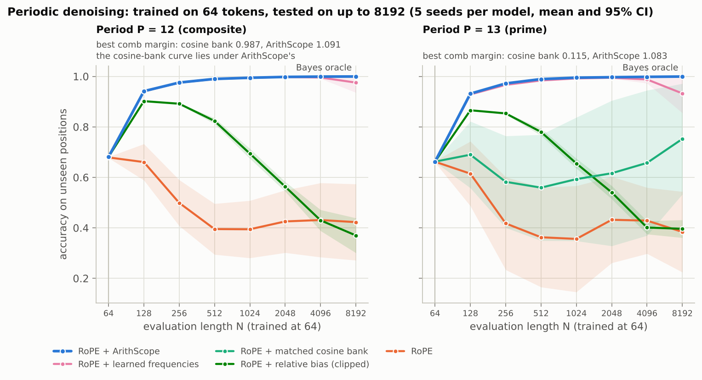
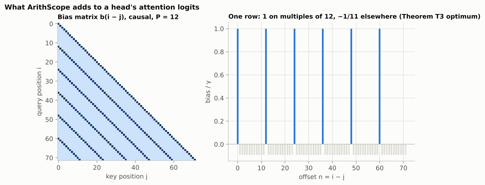
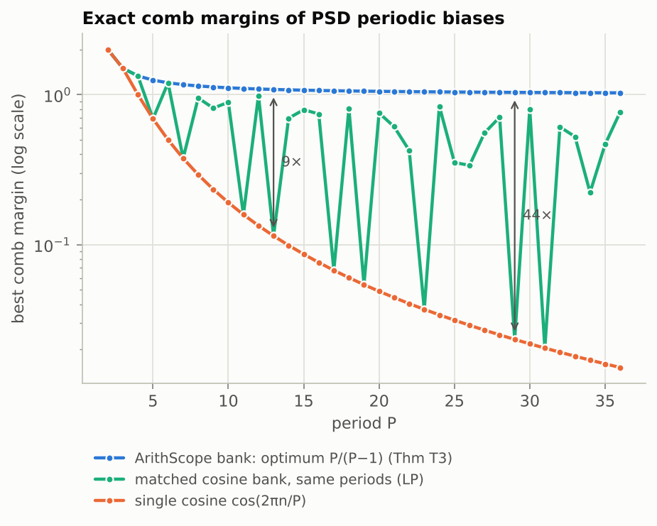
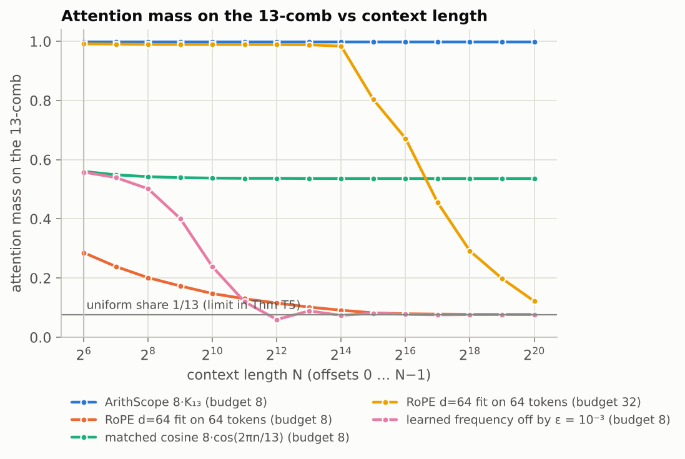
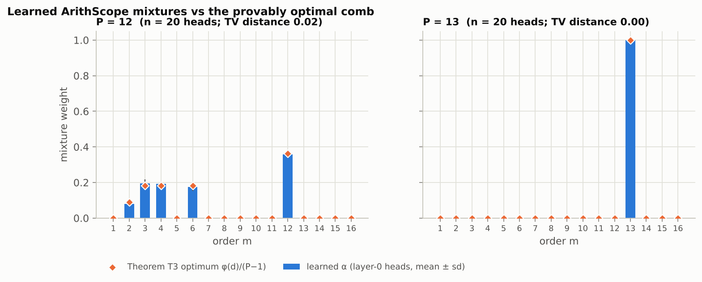
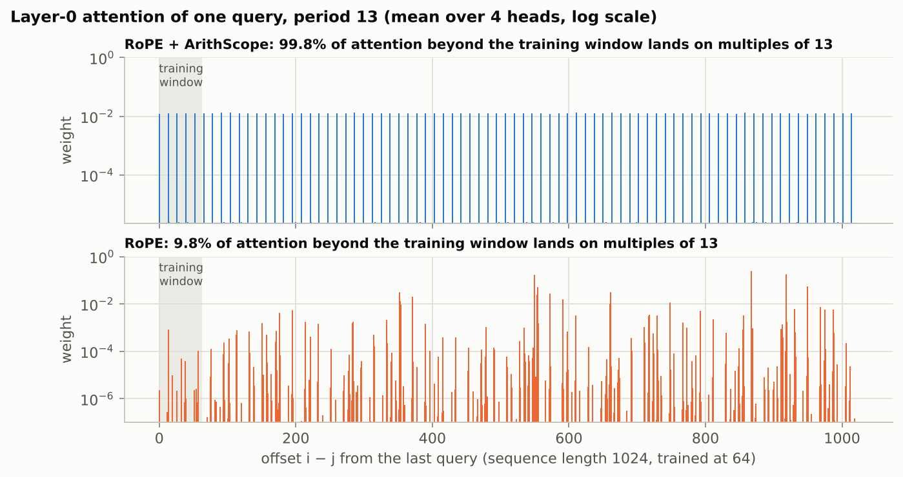
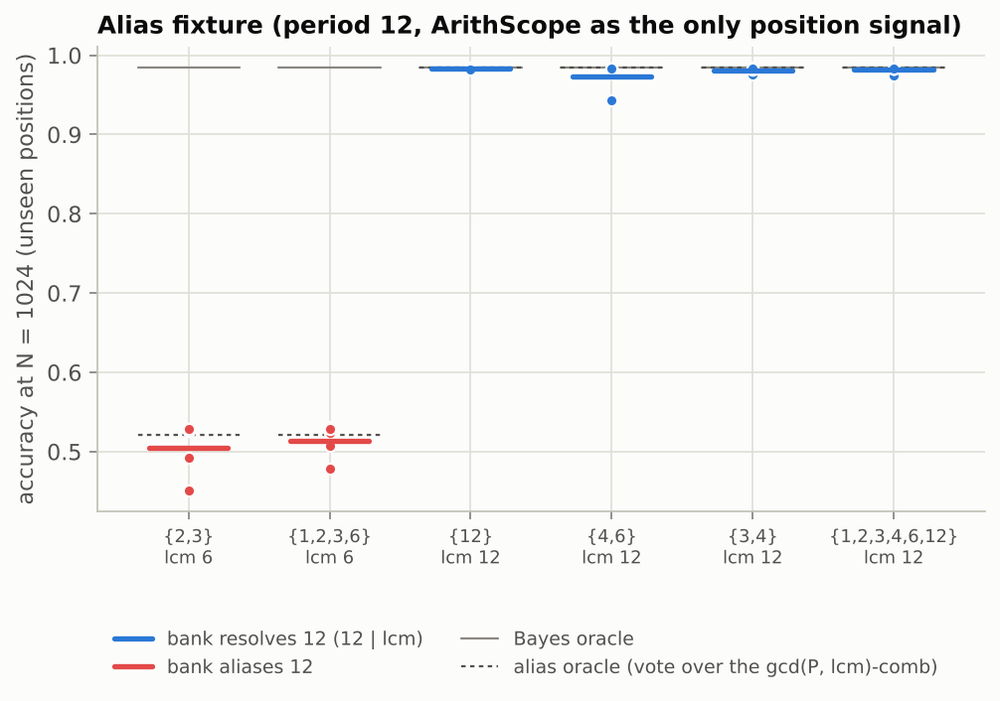
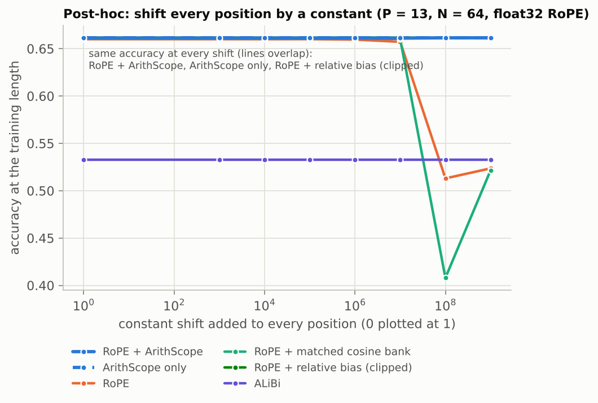
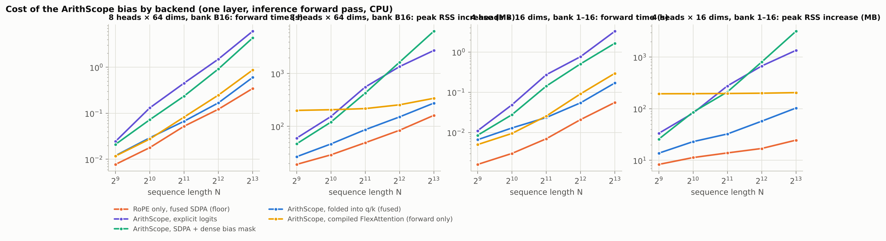

# ArithScope

**Exact arithmetic position channels for Transformer attention.**

Some attention heads need to "look every *P* tokens back": rows of a serialized table, bars of music, codons, fixed-width records. With RoPE, such a pattern decays as the context grows: its rotary frequencies are incommensurate, so the attention a head puts on any residue class mod *P* drifts toward the uniform share 1/*P* (Theorem T5). ArithScope adds one zero-initialized term to each head. The term is built from Ramanujan sums and computed with integer arithmetic on the offset `i − j`, so the periodic pattern a head learns on 64 tokens is reproduced exactly at any offset and any absolute position.

```math
\mathrm{logit}_h(i,j) \;=\; \frac{q_i^{\top}k_j}{\sqrt{d}} \;+\; \gamma_h \sum_{m \in M} \alpha_{h,m}\,\frac{c_m(i-j)}{\varphi(m)},
\qquad
c_m(n) \;=\; \sum_{\substack{1 \le a \le m \\ \gcd(a,m) = 1}} e^{2\pi i a n / m} \;\in\; \mathbb{Z}
```

Here `γ_h` starts at 0, `α_h` is a learned softmax over the orders `M = {1, …, 16}`, and `φ` is Euler's totient. That is 17 parameters per head.

<p align="center">
  <picture>
    <source media="(prefers-color-scheme: dark)" srcset="results/figures/hero_dark.png">
    
  </picture>
</p>

<!-- AUTO:tldr:BEGIN -->
- **Length extrapolation.** Trained on 64 tokens, RoPE + ArithScope stays within 0.1 pp of the Bayes-optimal predictor on unseen positions at every tested length up to 8,192 tokens (128× the training length), at both periods. At 8,192 tokens RoPE alone scores 38.4% (period 13) and 42.3% (period 12), against 99.9% for the Bayes oracle.
- **The basis matters where theory says it should.** A cosine bank with the same periods and parameter count scores 59.3% at period 13 (N = 1,024) against 99.5% for ArithScope. At period 12, where the two channels' optimal comb margins nearly coincide (0.987 vs 1.091), it scores 99.4% against 99.5%.
- **Gradient descent finds the provably optimal comb.** Offered 16 orders, layer-0 heads trained at period 13 put 100.0% of their mixture weight on order 13, the unique optimum of Theorem T3 (total-variation distance 0.000, 20 heads).
- **Identifiability theory predicts which banks fail.** In the alias fixture (period 12), banks with lcm 6 stay below their alias ceiling (0.7–1.6 pp below), whatever their size; every bank with 12 | lcm ends within 1.1 pp of the Bayes oracle, including one- and two-order banks.
- **No measurable cost on aperiodic data.** On tagged denoising, adding ArithScope to RoPE changes accuracy at the training length by -0.01 pp (95% CI [-0.09, +0.07]).
- **Exact at any absolute position (post hoc).** At period 13 and the training length, shifting every position by 10<sup>9</sup> leaves RoPE + ArithScope at 66.1% and ArithScope alone at 66.1% (unshifted: 66.1% and 66.1%). RoPE alone, whose rotary angles are float32, drops from 66.0% to 52.4%.
<!-- AUTO:tldr:END -->

> **Scope.** This is computation-layer research on the attention mechanism, done with small models on synthetic tasks on CPU. It makes no claims about natural language, pretrained LLMs, or speed. See [Scope and limitations](#scope-and-limitations).

## Preregistered verdicts

The four confirmatory claims and their decision rules were committed in [`cdea384`](https://github.com/Akari-H-111/ArithScope/commit/cdea384eb0966a544365a2a6427bd6e1bc930ae7) before the first confirmatory run started ([`docs/PREREGISTRATION.md`](docs/PREREGISTRATION.md)). The verdicts below apply those rules mechanically ([`experiments/analyze.py`](experiments/analyze.py), function `findings`):

<!-- AUTO:findings:BEGIN -->
- **C1 (periodic extrapolation vs RoPE): supported.** RoPE + ArithScope minus RoPE, unseen positions at N = 1024: P = 12: +60.0 pp, 95% CI [+48.7, +71.4], 5/5 seeds; P = 13: +63.9 pp, 95% CI [+42.9, +84.9], 5/5 seeds.
- **C2 (prime period vs the matched cosine bank): supported.** P = 13, N = 1024: +40.2 pp, 95% CI [+15.7, +64.7], 5/5 seeds. At P = 12, where theory predicts no meaningful gap: +0.0 pp, 95% CI [-0.0, +0.0], 4/5 seeds.
- **C3 (identifiability / alias fixture, P = 12): supported.** Aliased banks: {2,3} 50.5% (ceiling 52.1%), {1,2,3,6} 51.4% (ceiling 52.1%). Resolving banks: {12} 98.3% (Bayes 98.4%), {4,6} 97.4% (Bayes 98.4%), {3,4} 98.1% (Bayes 98.4%), {1,2,3,4,6,12} 98.1% (Bayes 98.4%).
- **C4 (no harm on the aperiodic control): supported.** Tagged denoising, RoPE + ArithScope minus RoPE at N = 64: -0.0 pp, 95% CI [-0.1, +0.1], 3/5 seeds (margin: lower bound > −1 pp).
- **S1 (drift of learned frequencies, N = 1024 → 8192): observed; ArithScope within 1 pp of Bayes at both lengths: yes.** P = 12: learned frequencies 99.4% → 97.5%, ArithScope 99.5% → 100.0% (Bayes 99.4% → 99.9%); P = 13: learned frequencies 99.2% → 93.3%, ArithScope 99.5% → 99.9% (Bayes 99.5% → 99.9%).
- **S2 (learned mixtures), P = 12:** layer-0 heads put 100.0% of their mixture mass on divisors of 12 (largest weight: order 12, 35.9%); total-variation distance to the Theorem T3 optimum 0.024; comb margin 1.058 vs optimum 1.091 (20 heads).
- **S2 (learned mixtures), P = 13:** layer-0 heads put 100.0% of their mixture mass on divisors of 13 (largest weight: order 13, 100.0%); total-variation distance to the Theorem T3 optimum 0.000; comb margin 1.083 vs optimum 1.083 (20 heads).
<!-- AUTO:findings:END -->

Every comparison is paired. For a given seed, all variants start from bitwise-identical backbone weights and see the same training batches; only the position mechanism differs. Every accuracy is reported next to the exact Bayes oracle computed on the same test examples.

## What is in this repository

- **Theory** ([`docs/MATH.md`](docs/MATH.md)). The ArithScope channel contains the *unique optimal* positive-definite periodic attention bias. A cosine bank with the same periods is up to `~P²/(2π²)` times weaker at prime periods. Under standard RoPE frequencies, positional attention becomes asymptotically blind to residues. Each claim carries an evidence label, and every exact claim is also verified exhaustively on finite ranges with rational arithmetic.
- **Implementation** ([`arithscope/`](arithscope)). A drop-in PyTorch attention module with four backends that compute the same function. One folds the bias into the queries and keys, so it runs inside fused `scaled_dot_product_attention` with no `N × N` bias tensor. Another expresses every bias as a FlexAttention `score_mod` (forward pass verified on CPU, eager and compiled). The baselines (RoPE, ALiBi, NoPE, two cosine banks, learned frequencies, a clipped relative bias) share the same interface.
- **Evidence** ([`docs/RESULTS.md`](docs/RESULTS.md)). 182 confirmatory training runs under the frozen protocol: 4 suites, 5 seeds for the primary claims. Each run is one immutable JSON file under [`results/runs/`](results/runs).

## The problem

An attention head that should attend to `{t − P, t − 2P, …}` needs a positional score that peaks on the comb `PZ` at **every** distance:

- **Learned relative biases** are clipped beyond the training range.
- **ALiBi** decays monotonically with distance.
- **RoPE** scores offsets with frequencies `θ_k = b^(−2k/d)`. For an integer base `b` these are algebraic numbers, so by Lindemann's theorem no integer combination of them is a nonzero rational multiple of 2π. The closure of the phase orbit `nθ` is therefore a *connected* torus. By Weyl equidistribution, the share of attention a fixed RoPE head puts on any residue class mod *P* tends to `1/P` as the context grows (Theorem T5). The theorem is asymptotic; the numerical note in `MATH.md` shows how long a well-optimized head can hold out.

## The mechanism

The Ramanujan sum `c_m(n)` is an integer with the closed form `μ(q) φ(m)/φ(q)`, where `q = m / gcd(m, n)`. ArithScope uses the normalized kernel `K_m(n) = c_m(n)/φ(m)`. The dense path evaluates it by table lookup on `n mod m` in int64, and the folded path computes its phases from exact residues, so neither accumulates phase error with position.

<p align="center">
  <picture>
    <source media="(prefers-color-scheme: dark)" srcset="results/figures/mechanism_dark.png">
    
  </picture>
</p>

Three properties make it a good attention channel:

1. **Sharp, exact combs.** `K_m(n) = 1` exactly when `m | n`; everywhere else `K_m(n) ≤ 1/2` (Lemma L2).
2. **Provable optimality.** Among *all* positive-definite `P`-periodic biases, the best comb (margin `P/(P−1)`) is unique, and it is a convex Ramanujan mixture: `Σ_{d|P, d>1} φ(d)/(P−1) · K_d` (Theorem T3). The figure above shows it for `P = 12`. Combining orders works like the Chinese remainder theorem: a head can select exactly the combs `lcm(S)·Z` for subsets `S` of its bank (Theorem T4).
3. **Fused-kernel friendly.** `K_m(i − j)` factors exactly through `φ(m)` real features. The whole bias folds into 80 extra query/key dimensions (for `M = {1, …, 16}`), so it runs inside `scaled_dot_product_attention(is_causal=True)` (Theorem T7).

`γ` starts at 0, so adding ArithScope to a model changes nothing until training moves it. The tests check this bitwise, for outputs **and** gradients.

```python
from arithscope.attention import CausalSelfAttention, PositionConfig

attn = CausalSelfAttention(d_model=64, num_heads=4, pos=PositionConfig.from_name("rope+arith"))
y = attn(x, positions)                      # explicit logits (reference)
y = attn(x, positions, backend="folded")    # same function in fused SDPA, no N x N bias
```

A fourth backend, `backend="flex"`, turns every bias into a FlexAttention `score_mod` that reads one per-head table of `2N − 1` offset values; `arithscope.flex.compile_kernels()` switches it to compiled, fused kernels. On CPU its forward pass matches the explicit backend (1e−12 in float64 eager, 1e−5 in float32 compiled). Its backward pass and GPU kernels are not tested here.

## Theory at a glance

Full statements, proofs, and evidence labels are in [`docs/MATH.md`](docs/MATH.md). No statement was checked by a proof assistant; "checked" means exhaustive exact verification on the stated finite range.

| | Statement | Status |
|---|---|---|
| L2 | Off the comb, `K_m ≤ 1/2` (attained iff `6 \| m`); `≤ 0` for prime powers | proved; checked for m < 400 |
| T3 | The optimal positive-definite `P`-periodic comb is unique, has margin `P/(P−1)`, and is a convex Ramanujan mixture | proved; checked for P < 80, LP for P ≤ 36 |
| C3.1 | The matched cosine bank has margin `2 sin²(π/P)` at prime periods: 9× weaker at P = 13, 44× at P = 29 | proved (primes); LP (composites) |
| T4 | A head's selectable combs are exactly `lcm(S)·Z`; CRT composition has margin `≥ 1/k` | proved; checked for P < 300 |
| P1 | No bias in the span separates offsets with equal signature (the alias and identifiability classes) | proved; checked |
| T5 | With standard RoPE frequencies, positional attention mass on any residue class tends to `1/P` | asymptotic proof, no rate |
| T7 | Exact rank-`Σφ(m)` factorization, so the bias runs inside fused attention | proved; checked to 1e−12 |

<p align="center">
  <picture>
    <source media="(prefers-color-scheme: dark)" srcset="results/figures/theory_comb_margin_dark.png">
    
  </picture>
  <picture>
    <source media="(prefers-color-scheme: dark)" srcset="results/figures/theory_comb_mass_dark.png">
    
  </picture>
</p>

## Results

Trained at length 64, evaluated up to 8,192 (E1); the identifiability fixture (E2); an aperiodic control task (E3); and unlabeled mixed periods (E5, exploratory). All tables, per-seed values, and paired differences are in [`docs/RESULTS.md`](docs/RESULTS.md).

<!-- AUTO:headline:BEGIN -->
| period | model | N = 1024 (16× train length) | N = 8192 (128× train length) |
|---|---|---|---|
| 12 | RoPE + ArithScope | 99.5 ± 0.0 | 100.0 ± 0.0 |
| 12 | RoPE | 39.4 ± 11.4 | 42.3 ± 15.1 |
| 12 | RoPE + matched cosine bank | 99.4 ± 0.0 | 100.0 ± 0.0 |
| 12 | RoPE + relative bias (clipped) | 69.4 ± 2.0 | 37.0 ± 6.9 |
| 12 | RoPE + learned frequencies | 99.4 ± 0.1 | 97.5 ± 3.9 |
| 12 | *Bayes oracle* | 99.4 | 99.9 |
| 13 | RoPE + ArithScope | 99.5 ± 0.0 | 99.9 ± 0.0 |
| 13 | RoPE | 35.6 ± 21.0 | 38.4 ± 16.0 |
| 13 | RoPE + matched cosine bank | 59.3 ± 24.5 | 75.2 ± 21.9 |
| 13 | RoPE + relative bias (clipped) | 65.5 ± 2.0 | 39.6 ± 3.5 |
| 13 | RoPE + learned frequencies | 99.2 ± 0.2 | 93.3 ± 7.8 |
| 13 | *Bayes oracle* | 99.5 | 99.9 |

Accuracy (%) on positions never seen in training (t ≥ 64), mean ± 95% CI over 5 seeds; generated by `experiments/analyze.py`.
<!-- AUTO:headline:END -->

### What the trained heads learn

The learned mixture weights `α` can be compared with the provably optimal comb of Theorem T3, since that optimum is known in closed form.

<p align="center">
  <picture>
    <source media="(prefers-color-scheme: dark)" srcset="results/figures/e1_alpha_dark.png">
    
  </picture>
</p>

The resulting attention, for one query at the end of a 1,024-token sequence (16× the training length):

<p align="center">
  <picture>
    <source media="(prefers-color-scheme: dark)" srcset="results/figures/attention_profile_dark.png">
    
  </picture>
</p>

### Identifiability: which banks can find period 12

Theory (P1, T4) says an ArithScope head cannot tell offsets apart unless the bank's lcm resolves them. A bank with lcm 6 therefore cannot separate offset 6 from offset 12, no matter how many orders it has; a two-order bank with lcm 12 can. E2 tests exactly this, with ArithScope as the only positional signal.

<p align="center">
  <picture>
    <source media="(prefers-color-scheme: dark)" srcset="results/figures/e2_alias_dark.png">
    
  </picture>
</p>

### Absolute position (post hoc)

The ArithScope term reads only `(i − j) mod m` in int64, so it is bitwise invariant under any common shift of positions. RoPE evaluates `tθ` in float32. In the test below, models that carry the period in an exact additive channel keep their accuracy at every shift. RoPE alone loses it at the largest shifts, and so does the matched cosine bank at period 13, which leans on its rotary part. The test was added after the preregistration and is labeled post hoc; see [`docs/PREREGISTRATION.md`](docs/PREREGISTRATION.md), Section 8.

<p align="center">
  <picture>
    <source media="(prefers-color-scheme: dark)" srcset="results/figures/e1_shift_dark.png">
    
  </picture>
</p>

<!-- AUTO:calibration:BEGIN -->
<!-- AUTO:calibration:END -->

<!-- AUTO:overhead:BEGIN -->
### Cost

<p align="center">
  <picture>
    <source media="(prefers-color-scheme: dark)" srcset="results/figures/overhead_dark.png">
    
  </picture>
</p>

One attention layer, inference forward pass, batch 1, CPU with 4 threads (`experiments/bench_overhead.py`). In the LLM-sized configuration (8 heads of dimension 64, prime-power bank `B_16`, 55 folded dimensions) at N = 8,192, ArithScope takes 599.3 ms (folded), 869.3 ms (compiled FlexAttention), 6040.8 ms (explicit bias), against 344.9 ms for RoPE alone in fused SDPA. Peak memory grows by 275 MB (folded), 340 MB (compiled FlexAttention), 2738 MB (explicit bias), 161 MB (RoPE alone). The compiled FlexAttention figure includes one-time compilation; at N = 512 it already adds 201 MB. A training step (forward and backward) at N = 8,192 takes 1905.8 ms and 503 MB with the folded path, against 1089.0 ms and 315 MB for RoPE alone; the explicit and dense-mask paths were not run there (dense [H,N,N] tensors would need ~6.0 GB). These are single-machine CPU measurements, not a speed claim; full tables are in [`docs/RESULTS.md`](docs/RESULTS.md).
<!-- AUTO:overhead:END -->

## What did not work

Negative results are kept, with their run files. The first three come from development pilots; their numbers are copied from the pilot tables in [`docs/EXECUTION_LEDGER.md`](docs/EXECUTION_LEDGER.md). An external cold audit of the released code found two library defects and an error in the theory notes; all are fixed and documented in [`docs/AUDIT_RESPONSE.md`](docs/AUDIT_RESPONSE.md).

- **MQAR was dropped before the confirmatory runs.** No variant learned multi-query associative recall within the budget (6–27% against a 100% oracle; 19% in an easier setting). A floor effect cannot test "no harm", so claim C4 rests on the tagged-denoising control alone.
- **The first alias fixture leaked information.** In dense denoising, the model's own noisy token breaks the tie between aliased candidates, so the model beat the "alias ceiling" (72% vs about 53%). The fixture was redesigned with uninformative query tokens before any confirmatory run.
- **A correct comb is not enough to generalize.** With period 24 and training length 64, a resolving bank learned exactly the right mixture but did not extrapolate (52% against a 95% Bayes oracle): a query saw at most three comb positions in training, so the content readout met a distribution shift at long lengths. Period 12 shows six comb positions per window and was adopted instead.
- **Near-oracle accuracy hides a calibration cost.** RoPE + ArithScope matches the oracle's accuracy at 8,192 tokens, but its NLL grows with length while ArithScope alone does not (see Calibration above). The preregistered claims were about accuracy only.
- **Learned frequencies are a strong baseline.** Free frequencies (16 per head, initialized at log-spaced periods from 2 to 32, phases in float64, same positional learning rate) come within about a point of ArithScope up to 2,048 tokens. They lose accuracy only at the longest lengths, after their comb has drifted, as the drift remark under Theorem T5 predicts (claim S1, and the post-hoc drift analysis in [`docs/RESULTS.md`](docs/RESULTS.md)).

## Scope and limitations

- **Synthetic tasks, tiny models, CPU.** Two layers, `d_model = 64`, 2,000 training steps. The tasks are designed so that periodic attention is Bayes-optimal; they test a mechanism, not language modeling.
- **Not more expressive than a full Fourier bank.** A cosine bank with all 41 reduced frequencies contains every Ramanujan kernel in its span and matches ArithScope in E1. The contribution is the parameterization (one weight per order, a provably optimal comb, exact residues), not a pattern that no Fourier method can represent.
- **ArithScope cannot express offset-specific patterns.** A head only sees `gcd(i − j, m)`, so "previous token" is out of reach. This is why the practical variant is `RoPE + ArithScope`.
- **Not sub-quadratic.** The folded backend removes the `[N, N]` bias memory, not the quadratic attention compute.
- **T5 is asymptotic.** A well-optimized RoPE head with large logits can hold a comb for thousands of tokens before it decays (see the theory figure above).
- **Natural data is untested.** Periodic structure in real data is noisy and partial. Testing it is the first item in [`docs/HANDOFF.md`](docs/HANDOFF.md).

## Reproduce

```bash
# Python >= 3.10; torch >= 2.4 (CPU is enough), numpy, scipy, matplotlib, pytest
# exact environment: environment.yml, results/environment/conda-explicit.lock
make oracle        # exact arithmetic checks, standard library only
make test          # 65 tests (one opt-in): oracle match, masks, position layouts, gradients, gamma = 0, backends, Bayes oracles
make lint          # ruff
make theory        # theory figures and results/summary/theory.json
make experiments   # the four preregistered suites, 182 runs (resumable; about 3 hours with 4 CPU workers)
make analyze       # regenerates every table, figure, and AUTO block from results/runs/*.json
make lab           # rebuilds the interactive explainer, docs/lab/index.html
```

Each run writes one immutable JSON file with its config, environment, test-set hashes, training curve, per-length metrics next to the exact Bayes oracle, and learned positional parameters.

## Interactive explainer

[`docs/lab/index.html`](docs/lab/index.html) is a standalone page (no build step, no network) with a kernel explorer, the optimal comb against the cosine bank, an alias explorer, the RoPE comb-mass curves, and the experiment results. Open it locally in a browser, or serve `docs/` with GitHub Pages.

## Repository map

| Path | Contents |
|---|---|
| `arithscope/arith.py` | exact integer arithmetic, standard library only: Ramanujan sums, kernels, optimal combs, alias classes |
| `arithscope/bias.py` | ArithScope bias (dense and folded) and the baselines: cosine banks, learned frequencies, clipped relative bias, ALiBi |
| `arithscope/attention.py`, `flex.py`, `model.py`, `rope.py` | attention with four backends (explicit, SDPA, folded, FlexAttention); minimal decoder |
| `arithscope/tasks.py`, `train.py` | tasks with exact Bayes oracles; training and evaluation harness |
| `arithscope/theory.py` | linear programs and comb-mass computations behind the theory figures |
| `docs/` | [`MATH.md`](docs/MATH.md), [`PREREGISTRATION.md`](docs/PREREGISTRATION.md), [`RESULTS.md`](docs/RESULTS.md), [`CLAIM_LEDGER.md`](docs/CLAIM_LEDGER.md), [`SPEC.md`](docs/SPEC.md), [`HANDOFF.md`](docs/HANDOFF.md), [`EXECUTION_LEDGER.md`](docs/EXECUTION_LEDGER.md) |
| `experiments/` | suites, runner, analysis, figures, post-hoc scripts, overhead benchmark, explainer build |
| `results/` | run files, summaries, figures, environment lock |
| `reference/` | the original standard-library oracle from the planning package, kept byte-identical |

## Related work

- **Position encodings and length generalization:** RoPE (Su et al., 2021), ALiBi (Press et al., 2022), T5 relative bias (Raffel et al., 2020), NoPE (Kazemnejad et al., 2023), FIRE (Li et al., 2024), FoPE (Hua et al., 2025).
- **RoPE numerics at long context:** Wang et al. (2024, BF16 breaks RoPE); Liu (2026, RoPE as phase modulation).
- **Ramanujan sums in signal processing:** Vaidyanathan (2014).
- **Prime-indexed Fourier features for integer *values*:** Hwang, Bae & Lee (2026).

A literature screen (2026-10-14) found no prior use of Ramanujan sums as an attention bias. The screen is not exhaustive. Ramanujan sums, Fourier position features, and relative biases are each classical; the contribution is their combination into this attention channel, its theory, and the measured comparison. Full references are in [`docs/MATH.md`](docs/MATH.md).

## Citation and license

See [`CITATION.cff`](CITATION.cff). Code, documentation, and results are released under the [MIT License](LICENSE).
