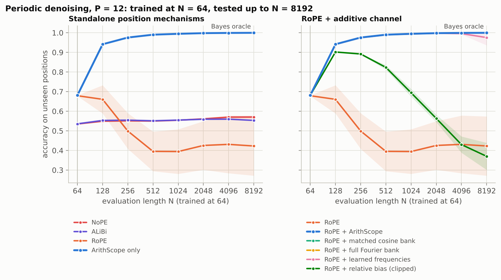
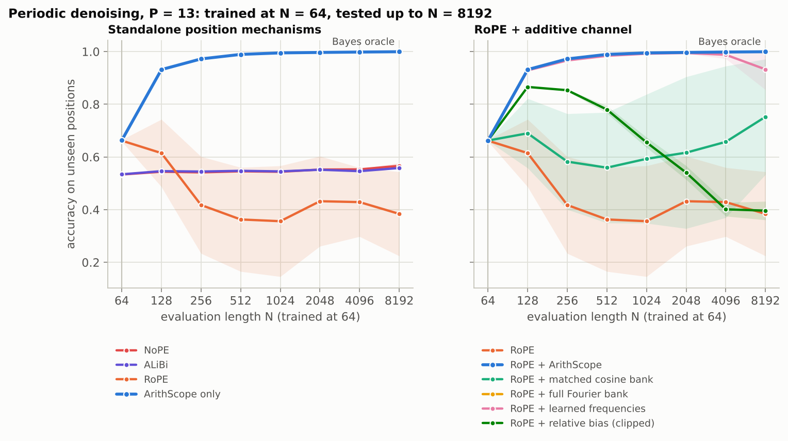
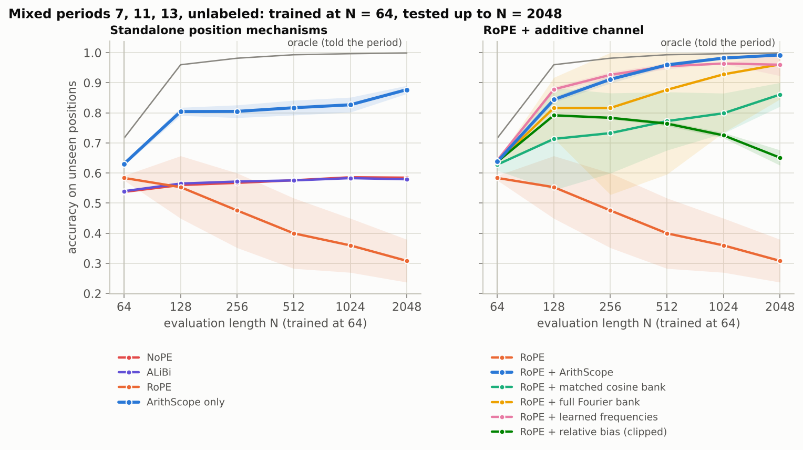
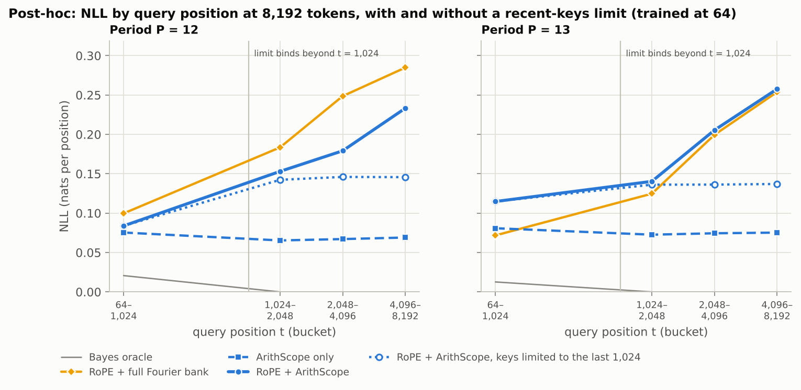
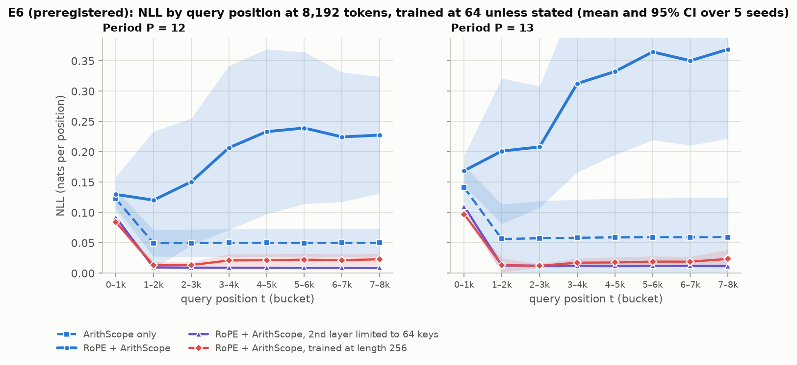
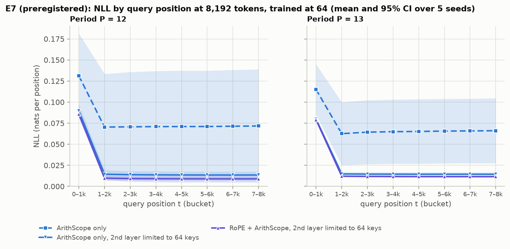
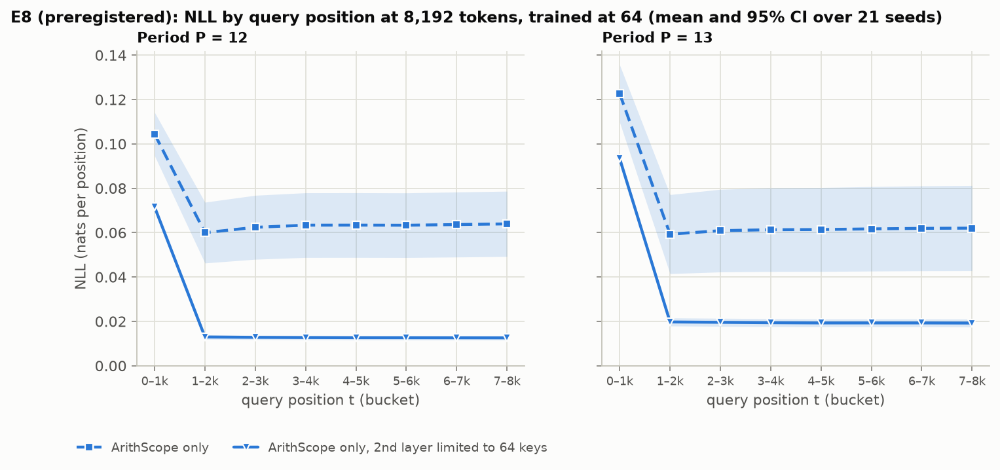
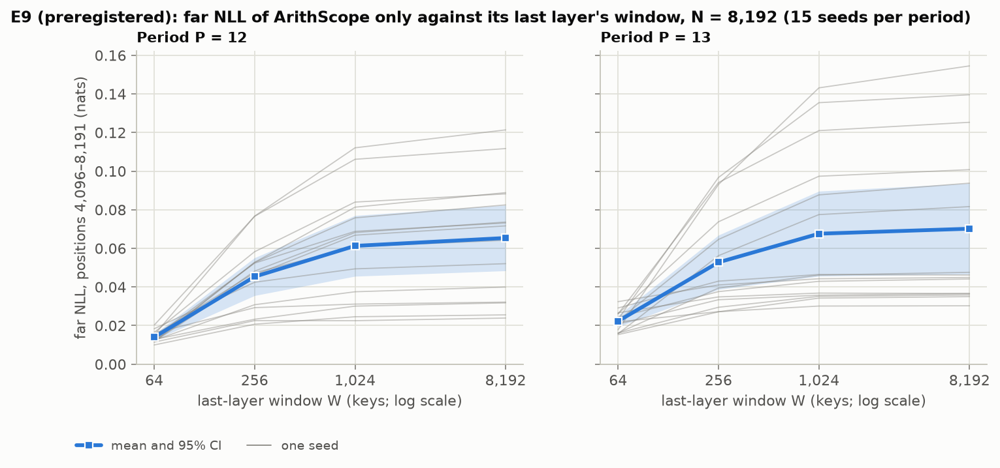
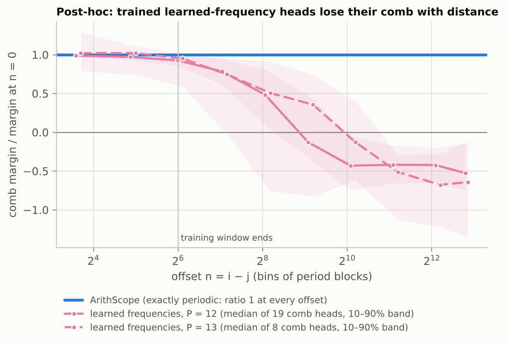

# Results

Protocol: [`PREREGISTRATION.md`](PREREGISTRATION.md). Theory: [`MATH.md`](MATH.md). Run records: `results/runs/`.

Every number in the AUTO blocks is generated by `experiments/analyze.py` from the run files; nothing between AUTO markers is edited by hand. Interpretation follows the blocks.

## Preregistered verdicts

The decision rules from the preregistration, applied mechanically by `experiments/analyze.py`:

<!-- AUTO:findings:BEGIN -->
- **C1 (periodic extrapolation vs RoPE): supported.** RoPE + ArithScope minus RoPE, unseen positions at N = 1024: P = 12: +60.0 pp, 95% CI [+48.7, +71.4], 5/5 seeds; P = 13: +63.9 pp, 95% CI [+42.9, +84.9], 5/5 seeds.
- **C2 (prime period vs the matched cosine bank): supported.** P = 13, N = 1024: +40.2 pp, 95% CI [+15.7, +64.7], 5/5 seeds. At P = 12, where theory predicts no meaningful gap: +0.0 pp, 95% CI [-0.0, +0.0], 4/5 seeds.
- **C3 (identifiability / alias fixture, P = 12): supported.** Aliased banks: {2,3} 50.5% (ceiling 52.1%), {1,2,3,6} 51.4% (ceiling 52.1%). Resolving banks: {12} 98.3% (Bayes 98.4%), {4,6} 97.4% (Bayes 98.4%), {3,4} 98.1% (Bayes 98.4%), {1,2,3,4,6,12} 98.1% (Bayes 98.4%).
- **C4 (no harm on the aperiodic control): supported.** Tagged denoising, RoPE + ArithScope minus RoPE at N = 64: -0.0 pp, 95% CI [-0.1, +0.1], 3/5 seeds (margin: lower bound > −1 pp).
- **S1 (drift of learned frequencies, N = 1024 → 8192): observed; ArithScope within 1 pp of Bayes at both lengths: yes.** P = 12: learned frequencies 99.4% → 97.5%, ArithScope 99.5% → 100.0% (Bayes 99.4% → 99.9%); P = 13: learned frequencies 99.2% → 93.3%, ArithScope 99.5% → 99.9% (Bayes 99.5% → 99.9%).
- **S2 (learned mixtures), P = 12:** layer-0 heads put 100.0% of their mixture mass on divisors of 12 (largest weight: order 12, 35.9%); total-variation distance to the Theorem T3 optimum 0.024; comb margin 1.058 vs optimum 1.091 (20 heads).
- **S2 (learned mixtures), P = 13:** layer-0 heads put 100.0% of their mixture mass on divisors of 13 (largest weight: order 13, 100.0%); total-variation distance to the Theorem T3 optimum 0.000; comb margin 1.083 vs optimum 1.083 (20 heads).
<!-- AUTO:findings:END -->

### E6: calibration at long lengths (second preregistration)

Decision rules from [`PREREGISTRATION.md`](PREREGISTRATION.md), Section 9, applied by `experiments/e6_verdicts.py` (committed before any E6 run) and reported by `experiments/analyze.py`. Far NLL is the mean NLL on positions 4,096–8,191 at N = 8,192:

<!-- AUTO:e6_findings:BEGIN -->
- **Sanity check (window and baseline train bitwise alike): passed.**
- **L1 (second-layer window equal to the training length): supported.** Window minus RoPE + ArithScope: P = 12: far NLL -0.222, 95% CI [-0.335, -0.109], lower in 5/5 seeds; accuracy lower bound +0.00 pp; P = 13: far NLL -0.342, 95% CI [-0.480, -0.204], lower in 5/5 seeds; accuracy lower bound +0.00 pp.
- **L2 (training at length 256, same tokens per step): supported.** Longer training minus RoPE + ArithScope: P = 12: far NLL -0.209, 95% CI [-0.326, -0.093], lower in 5/5 seeds; accuracy lower bound +0.00 pp; P = 13: far NLL -0.334, 95% CI [-0.471, -0.198], lower in 5/5 seeds; accuracy lower bound +0.00 pp.
- **S3 (window flat, mean growth within ±0.02 nats): as predicted.** Growth P = 12: -0.0008, P = 13: -0.0009 (RoPE + ArithScope: P = 12: +0.1072, P = 13: +0.1677).
- **S4 (window stays above ArithScope only): not as predicted.** Window minus ArithScope only, far NLL: P = 12: -0.041, 95% CI [-0.065, -0.017]; P = 13: -0.047, 95% CI [-0.112, +0.018].
- **S5 (longer training still grows): as predicted.** Growth P = 12: +0.0098, P = 13: +0.0101.
<!-- AUTO:e6_findings:END -->

### E7: the NLL floor of ArithScope alone (third preregistration)

Decision rules from [`PREREGISTRATION.md`](PREREGISTRATION.md), Section 10, applied by `experiments/e7_verdicts.py` (committed and pushed before any E7 run) and reported by `experiments/analyze.py`. Metrics as in E6; "limited" means the second layer attends only to its last 64 keys:

<!-- AUTO:e7_findings:BEGIN -->
- **Sanity check (limited and unlimited ArithScope only train bitwise alike): passed.**
- **W1 (ArithScope only, second layer limited to 64 keys, has lower far NLL): falsified** (far NLL not lower than ArithScope alone at both periods). Limited minus unlimited: P = 12: -0.0578, 95% CI [-0.1205, +0.0049], negative in 5/5 seeds; accuracy lower bound +0.00 pp; P = 13: -0.0512, 95% CI [-0.0885, -0.0139], negative in 5/5 seeds; accuracy lower bound +0.00 pp.
- **S6 (the limit closes only part of the gap to RoPE + ArithScope limited): not as predicted.** ArithScope only limited minus RoPE + ArithScope limited: P = 12: +0.0046, 95% CI [-0.0009, +0.0100], negative in 1/5 seeds; P = 13: +0.0029, 95% CI [+0.0001, +0.0057], negative in 0/5 seeds.
- **S7 (E6's surprise replicates: RoPE + ArithScope limited ends below ArithScope only): not as predicted.** P = 12: -0.0624, 95% CI [-0.1300, +0.0053], negative in 5/5 seeds; P = 13: -0.0541, 95% CI [-0.0924, -0.0158], negative in 5/5 seeds.
- **Descriptive.** Mean far NLL of ArithScope only, unlimited and limited, and of RoPE + ArithScope limited: P = 12: unlimited 0.0713, limited 0.0135, RoPE + ArithScope limited 0.0089; P = 13: unlimited 0.0657, limited 0.0144, RoPE + ArithScope limited 0.0115. Share of the gap closed by the limit on ArithScope only: P = 12: 93%, P = 13: 95%.
<!-- AUTO:e7_findings:END -->

### E8: a powered retest of E7's W1 (fourth preregistration)

Decision rules from [`PREREGISTRATION.md`](PREREGISTRATION.md), Section 11, applied by `experiments/e8_verdicts.py` (committed and pushed before any E8 run) and reported by `experiments/analyze.py`. The seed count comes from `experiments/e8_power.py`, which planned it on E6's and E7's seed-to-seed spread. The arms and metrics are E7's, on 21 fresh seeds, new training batches, and new test data:

<!-- AUTO:e8_findings:BEGIN -->
- **Design.** 21 fresh seeds (6–26) per arm and period, from the preregistered power rule (planned joint power 0.90); no failed runs.
- **Sanity check (limited and unlimited ArithScope only train bitwise alike): passed.**
- **W2 (E7's W1 retested: ArithScope only, second layer limited to 64 keys, has lower far NLL): supported**. Limited minus unlimited: P = 12: -0.0510, 95% CI [-0.0656, -0.0363], negative in 21/21 seeds; accuracy lower bound +0.00 pp; P = 13: -0.0425, 95% CI [-0.0606, -0.0244], negative in 21/21 seeds; accuracy lower bound +0.00 pp.
- **S8 (seed-to-seed SD of far NLL at least 3× larger without the limit): as predicted.** P = 12: unlimited 0.0321, limited 0.0022 (ratio 14.7); P = 13: unlimited 0.0419, limited 0.0039 (ratio 10.7).
- **S9 (limited model flat, mean growth within ±0.02 nats): as predicted.** Growth P = 12: -0.0004; P = 13: -0.0005.
- **Descriptive.** Mean far NLL: P = 12: unlimited 0.0636, limited 0.0126; P = 13: unlimited 0.0618, limited 0.0193.
<!-- AUTO:e8_findings:END -->

### E9: a paired window dose-response (fifth preregistration)

Decision rules from [`PREREGISTRATION.md`](PREREGISTRATION.md), Section 12, applied by `experiments/e9_verdicts.py` (committed and pushed before any E9 run) and reported by `experiments/analyze.py`. ArithScope alone is trained once per seed, and the same weights are evaluated with the last layer limited to 64, 256, 1,024, and 8,192 keys (the last is the whole sequence). The seed count comes from `experiments/e9_power.py`, which was pushed before E8 finished and planned on E8's results:

<!-- AUTO:e9_findings:BEGIN -->
- **Design.** 15 fresh seeds (27–41) per period from the preregistered power rule (planned joint power 0.90), each trained once and evaluated with windows 64, 256, 1,024, 8,192; no failures.
- **Sanity checks (one checkpoint per seed across windows, one test set per period, one code commit): passed.**
- **R1 (far NLL rises with log2 of the last layer's window): supported**. Slope: P = 12: +0.0071 nats per doubling, 95% CI [+0.0048, +0.0094], positive in 15/15 seeds; accuracy lower bound +0.00 pp; P = 13: +0.0066 nats per doubling, 95% CI [+0.0033, +0.0099], positive in 15/15 seeds; accuracy lower bound +0.00 pp.
- **S10 (near-monotone, every step's lower bound above −0.005 nats): as predicted.** P = 12: smallest step bound +0.0023; P = 13: smallest step bound +0.0004.
- **S11 (W = 64 below the whole sequence; E8 replicates): as predicted.** P = 12: -0.0514, 95% CI [-0.0678, -0.0350]; P = 13: -0.0479, 95% CI [-0.0716, -0.0242].
- **Descriptive.** Mean far NLL at W = 64, 256, 1,024, 8,192: P = 12: 0.0140, 0.0453, 0.0613, 0.0654; P = 13: 0.0223, 0.0528, 0.0676, 0.0702.
<!-- AUTO:e9_findings:END -->

## Figures

All figures are regenerated by `make analyze` (light and dark versions in `results/figures/`).

**E1, every variant.** Accuracy on unseen positions against evaluation length, mean and 95% CI over 5 seeds. Left: standalone position mechanisms. Right: RoPE plus an additive channel.

<picture>
  <source media="(prefers-color-scheme: dark)" srcset="../results/figures/e1_periodic_P12_dark.png">
  
</picture>

<picture>
  <source media="(prefers-color-scheme: dark)" srcset="../results/figures/e1_periodic_P13_dark.png">
  
</picture>

**E5 (exploratory), unlabeled mixed periods 7, 11, 13.** Three seeds.

<picture>
  <source media="(prefers-color-scheme: dark)" srcset="../results/figures/e5_mixed_P7-11-13_dark.png">
  
</picture>

**Learned mixtures against Theorem T3** (S2), **the alias fixture** (C3), **the post-hoc shift test**, and **the attention profile of one query**:

<picture>
  <source media="(prefers-color-scheme: dark)" srcset="../results/figures/e1_alpha_dark.png">
  
</picture>

<picture>
  <source media="(prefers-color-scheme: dark)" srcset="../results/figures/e2_alias_dark.png">
  
</picture>

<picture>
  <source media="(prefers-color-scheme: dark)" srcset="../results/figures/e1_shift_dark.png">
  
</picture>

<picture>
  <source media="(prefers-color-scheme: dark)" srcset="../results/figures/attention_profile_dark.png">
  
</picture>

**Post hoc: NLL by query position** (after the external audit), **drift of learned frequencies** (S1 mechanism), and **cost of the bias by backend** (CPU):

<picture>
  <source media="(prefers-color-scheme: dark)" srcset="../results/figures/e1_nll_dark.png">
  
</picture>

**E6 (preregistered): two remedies for the NLL rise.** NLL by query position at 8,192 tokens on fresh test data, mean and 95% CI over 5 seeds:

<picture>
  <source media="(prefers-color-scheme: dark)" srcset="../results/figures/e6_nll_dark.png">
  
</picture>

**E7 (preregistered): the floor of ArithScope alone.** NLL by query position at 8,192 tokens on fresh test data, mean and 95% CI over 5 seeds:

<picture>
  <source media="(prefers-color-scheme: dark)" srcset="../results/figures/e7_nll_dark.png">
  
</picture>

**E8 (preregistered): the retest with 21 seeds.** NLL by query position at 8,192 tokens on fresh test data, mean and 95% CI over 21 seeds:

<picture>
  <source media="(prefers-color-scheme: dark)" srcset="../results/figures/e8_nll_dark.png">
  
</picture>

**E9 (preregistered): the window dose-response.** Far NLL of ArithScope only against the last layer's window, one line per seed (each seed's four points share its weights), with the mean and 95% CI:

<picture>
  <source media="(prefers-color-scheme: dark)" srcset="../results/figures/e9_dose_dark.png">
  
</picture>

<picture>
  <source media="(prefers-color-scheme: dark)" srcset="../results/figures/e1_drift_dark.png">
  
</picture>

<picture>
  <source media="(prefers-color-scheme: dark)" srcset="../results/figures/overhead_dark.png">
  
</picture>

## Tables

<!-- AUTO:tables:BEGIN -->
**E1 periodic denoising, P = 12.** Accuracy (%) as mean ± 95% CI half-width over seeds. For N > 64 only positions t ≥ 64 (never seen in training) are scored.

| variant | N=64 | N=128 | N=256 | N=512 | N=1024 | N=2048 | N=4096 | N=8192 |
|---|---|---|---|---|---|---|---|---|
| NoPE | 53.5 ± 0.0 | 54.9 ± 0.1 | 55.1 ± 0.1 | 55.0 ± 0.1 | 55.4 ± 0.2 | 56.1 ± 0.4 | 57.0 ± 0.6 | 57.0 ± 0.8 |
| ALiBi | 53.6 ± 0.0 | 55.3 ± 0.1 | 55.4 ± 0.1 | 55.1 ± 0.0 | 55.5 ± 0.1 | 55.9 ± 0.1 | 55.9 ± 0.1 | 55.3 ± 0.1 |
| RoPE | 67.9 ± 0.2 | 66.1 ± 7.2 | 49.9 ± 9.1 | 39.5 ± 10.1 | 39.4 ± 11.4 | 42.5 ± 12.4 | 43.1 ± 14.7 | 42.3 ± 15.1 |
| ArithScope only | 68.1 ± 0.1 | 94.1 ± 0.1 | 97.6 ± 0.1 | 99.0 ± 0.0 | 99.4 ± 0.0 | 99.8 ± 0.0 | 99.9 ± 0.0 | 100.0 ± 0.0 |
| RoPE + ArithScope | 68.1 ± 0.1 | 94.1 ± 0.1 | 97.6 ± 0.1 | 99.0 ± 0.0 | 99.5 ± 0.0 | 99.8 ± 0.0 | 99.9 ± 0.0 | 100.0 ± 0.0 |
| RoPE + matched cosine bank | 68.2 ± 0.2 | 94.1 ± 0.1 | 97.5 ± 0.1 | 99.0 ± 0.0 | 99.4 ± 0.0 | 99.8 ± 0.0 | 99.9 ± 0.0 | 100.0 ± 0.0 |
| RoPE + full Fourier bank | 68.1 ± 0.1 | 94.1 ± 0.1 | 97.6 ± 0.1 | 99.0 ± 0.0 | 99.4 ± 0.0 | 99.8 ± 0.0 | 99.9 ± 0.0 | 100.0 ± 0.0 |
| RoPE + learned frequencies | 68.1 ± 0.1 | 94.1 ± 0.1 | 97.5 ± 0.1 | 99.0 ± 0.1 | 99.4 ± 0.1 | 99.7 ± 0.1 | 99.6 ± 0.4 | 97.5 ± 3.9 |
| RoPE + relative bias (clipped) | 68.1 ± 0.2 | 90.2 ± 0.1 | 89.2 ± 0.2 | 82.3 ± 1.2 | 69.4 ± 2.0 | 56.3 ± 1.9 | 43.0 ± 4.2 | 37.0 ± 6.9 |
| *Bayes oracle* | 68.1 | 94.1 | 97.5 | 99.0 | 99.4 | 99.8 | 99.9 | 99.9 |

**E1 paired differences, P = 12** (RoPE + ArithScope minus control; mean, 95% CI, seeds won):

| control | N=64 | N=256 | N=1024 | N=2048 |
|---|---|---|---|---|
| RoPE | +0.2 pp [-0.0, +0.5] (4/5) | +47.7 pp [+38.5, +56.8] (5/5) | +60.0 pp [+48.7, +71.4] (5/5) | +57.2 pp [+44.9, +69.6] (5/5) |
| RoPE + matched cosine bank | -0.0 pp [-0.1, +0.1] (2/5) | +0.0 pp [-0.0, +0.0] (4/5) | +0.0 pp [-0.0, +0.0] (4/5) | +0.0 pp [-0.0, +0.0] (2/5) |
| RoPE + full Fourier bank | +0.0 pp [-0.0, +0.1] (3/5) | +0.0 pp [-0.0, +0.0] (3/5) | +0.0 pp [-0.0, +0.0] (3/5) | +0.0 pp [-0.0, +0.0] (3/5) |
| RoPE + learned frequencies | +0.1 pp [-0.1, +0.2] (4/5) | +0.1 pp [-0.0, +0.1] (4/5) | +0.0 pp [-0.0, +0.1] (3/5) | +0.1 pp [-0.0, +0.1] (4/5) |
| RoPE + relative bias (clipped) | +0.0 pp [-0.1, +0.2] (2/5) | +8.4 pp [+8.2, +8.6] (5/5) | +30.0 pp [+28.1, +32.0] (5/5) | +43.5 pp [+41.6, +45.4] (5/5) |

**E1 periodic denoising, P = 13.** Accuracy (%) as mean ± 95% CI half-width over seeds. For N > 64 only positions t ≥ 64 (never seen in training) are scored.

| variant | N=64 | N=128 | N=256 | N=512 | N=1024 | N=2048 | N=4096 | N=8192 |
|---|---|---|---|---|---|---|---|---|
| NoPE | 53.3 ± 0.0 | 54.4 ± 0.0 | 54.1 ± 0.1 | 54.6 ± 0.1 | 54.4 ± 0.1 | 55.2 ± 0.2 | 55.3 ± 0.2 | 56.6 ± 1.1 |
| ALiBi | 53.4 ± 0.0 | 54.6 ± 0.0 | 54.5 ± 0.1 | 54.7 ± 0.1 | 54.5 ± 0.1 | 55.1 ± 0.1 | 54.6 ± 0.2 | 55.8 ± 0.4 |
| RoPE | 66.2 ± 0.3 | 61.5 ± 12.8 | 41.8 ± 18.4 | 36.3 ± 19.7 | 35.6 ± 21.0 | 43.2 ± 17.1 | 42.9 ± 13.1 | 38.4 ± 16.0 |
| ArithScope only | 66.3 ± 0.2 | 93.2 ± 0.1 | 97.2 ± 0.0 | 98.9 ± 0.0 | 99.5 ± 0.0 | 99.7 ± 0.0 | 99.8 ± 0.0 | 99.9 ± 0.0 |
| RoPE + ArithScope | 66.2 ± 0.2 | 93.2 ± 0.1 | 97.2 ± 0.0 | 98.9 ± 0.0 | 99.5 ± 0.0 | 99.7 ± 0.0 | 99.8 ± 0.0 | 99.9 ± 0.0 |
| RoPE + matched cosine bank | 66.2 ± 0.1 | 69.0 ± 13.2 | 58.2 ± 18.2 | 55.9 ± 21.0 | 59.3 ± 24.5 | 61.6 ± 28.8 | 65.7 ± 28.8 | 75.2 ± 21.9 |
| RoPE + full Fourier bank | 66.3 ± 0.2 | 93.1 ± 0.1 | 97.2 ± 0.0 | 98.9 ± 0.0 | 99.5 ± 0.0 | 99.7 ± 0.0 | 99.8 ± 0.0 | 99.9 ± 0.0 |
| RoPE + learned frequencies | 66.3 ± 0.2 | 92.9 ± 0.4 | 96.6 ± 0.4 | 98.4 ± 0.3 | 99.2 ± 0.2 | 99.5 ± 0.3 | 98.8 ± 1.5 | 93.3 ± 7.8 |
| RoPE + relative bias (clipped) | 66.3 ± 0.1 | 86.6 ± 0.1 | 85.3 ± 0.4 | 78.0 ± 1.4 | 65.5 ± 2.0 | 54.0 ± 2.6 | 40.1 ± 2.6 | 39.6 ± 3.5 |
| *Bayes oracle* | 66.3 | 93.1 | 97.2 | 98.9 | 99.5 | 99.7 | 99.8 | 99.9 |

**E1 paired differences, P = 13** (RoPE + ArithScope minus control; mean, 95% CI, seeds won):

| control | N=64 | N=256 | N=1024 | N=2048 |
|---|---|---|---|---|
| RoPE | +0.1 pp [-0.2, +0.3] (2/5) | +55.4 pp [+37.0, +73.9] (5/5) | +63.9 pp [+42.9, +84.9] (5/5) | +56.5 pp [+39.4, +73.6] (5/5) |
| RoPE + matched cosine bank | +0.0 pp [-0.2, +0.2] (2/5) | +39.0 pp [+20.8, +57.1] (5/5) | +40.2 pp [+15.7, +64.7] (5/5) | +38.0 pp [+9.3, +66.8] (5/5) |
| RoPE + full Fourier bank | -0.0 pp [-0.1, -0.0] (1/5) | -0.0 pp [-0.0, +0.0] (3/5) | -0.0 pp [-0.0, +0.0] (1/5) | -0.0 pp [-0.0, +0.0] (2/5) |
| RoPE + learned frequencies | -0.0 pp [-0.2, +0.1] (1/5) | +0.6 pp [+0.2, +0.9] (5/5) | +0.3 pp [+0.1, +0.6] (5/5) | +0.2 pp [-0.1, +0.5] (4/5) |
| RoPE + relative bias (clipped) | -0.0 pp [-0.1, +0.0] (2/5) | +11.9 pp [+11.5, +12.2] (5/5) | +34.0 pp [+32.0, +35.9] (5/5) | +45.6 pp [+43.0, +48.2] (5/5) |

**E1 position-shift robustness, P = 13, N = 256** (accuracy %, mean over seeds):

| variant | 0 | 1e+03 | 1e+04 | 1e+05 | 1e+06 | 1e+07 | 1e+08 | 1e+09 |
|---|---|---|---|---|---|---|---|---|
| RoPE + ArithScope | 89.4 | 89.4 | 89.4 | 89.4 | 89.4 | 89.5 | 89.4 | 89.5 |
| ArithScope only | 89.4 | 89.4 | 89.4 | 89.4 | 89.4 | 89.4 | 89.4 | 89.4 |
| RoPE | 47.8 | 47.8 | 47.8 | 47.8 | 47.8 | 47.3 | 43.2 | 51.1 |
| RoPE + matched cosine bank | 60.2 | 60.2 | 60.2 | 60.2 | 60.2 | 60.5 | 37.6 | 56.9 |
| RoPE + relative bias (clipped) | 80.5 | 80.5 | 80.5 | 80.5 | 80.5 | 80.5 | 80.5 | 80.5 |
| ALiBi | 54.2 | 54.2 | 54.2 | 54.2 | 54.2 | 54.2 | 54.2 | 54.2 |

**Post-hoc (not preregistered): absolute-position shift at the training length, P = 12, N = 64** (accuracy %, mean over seeds; RoPE angles in float32):

| variant | 0 | 10^3 | 10^4 | 10^5 | 10^6 | 10^7 | 10^8 | 10^9 |
|---|---|---|---|---|---|---|---|---|
| RoPE + ArithScope | 68.1 | 68.1 | 68.1 | 68.1 | 68.1 | 68.1 | 68.1 | 68.1 |
| ArithScope only | 68.1 | 68.1 | 68.1 | 68.1 | 68.1 | 68.1 | 68.1 | 68.1 |
| RoPE | 67.8 | 67.8 | 67.8 | 67.8 | 67.8 | 67.8 | 50.7 | 52.1 |
| RoPE + matched cosine bank | 68.1 | 68.1 | 68.1 | 68.1 | 68.1 | 68.1 | 68.1 | 68.1 |
| RoPE + full Fourier bank | 68.1 | 68.1 | 68.1 | 68.1 | 68.1 | 68.1 | 68.1 | 68.1 |
| RoPE + learned frequencies | 68.1 | 68.1 | 68.1 | 68.1 | 68.1 | 68.1 | 68.1 | 68.1 |
| RoPE + relative bias (clipped) | 68.1 | 68.1 | 68.1 | 68.1 | 68.1 | 68.1 | 68.1 | 68.1 |
| ALiBi | 53.4 | 53.4 | 53.4 | 53.4 | 53.4 | 53.4 | 53.4 | 53.4 |
| NoPE | 53.3 | 53.3 | 53.3 | 53.3 | 53.3 | 53.3 | 53.3 | 53.3 |

**Post-hoc (not preregistered): absolute-position shift at the training length, P = 13, N = 64** (accuracy %, mean over seeds; RoPE angles in float32):

| variant | 0 | 10^3 | 10^4 | 10^5 | 10^6 | 10^7 | 10^8 | 10^9 |
|---|---|---|---|---|---|---|---|---|
| RoPE + ArithScope | 66.1 | 66.1 | 66.1 | 66.1 | 66.1 | 66.1 | 66.1 | 66.1 |
| ArithScope only | 66.1 | 66.1 | 66.1 | 66.1 | 66.1 | 66.1 | 66.1 | 66.1 |
| RoPE | 66.0 | 66.0 | 66.0 | 66.0 | 66.0 | 65.7 | 51.3 | 52.4 |
| RoPE + matched cosine bank | 66.1 | 66.1 | 66.1 | 66.1 | 66.1 | 66.0 | 40.8 | 52.2 |
| RoPE + full Fourier bank | 66.1 | 66.1 | 66.1 | 66.1 | 66.1 | 66.1 | 66.1 | 66.2 |
| RoPE + learned frequencies | 66.1 | 66.1 | 66.1 | 66.1 | 66.1 | 66.1 | 66.2 | 66.2 |
| RoPE + relative bias (clipped) | 66.2 | 66.2 | 66.2 | 66.2 | 66.2 | 66.2 | 66.1 | 66.2 |
| ALiBi | 53.3 | 53.3 | 53.3 | 53.3 | 53.3 | 53.3 | 53.3 | 53.3 |
| NoPE | 53.2 | 53.2 | 53.2 | 53.2 | 53.2 | 53.2 | 53.2 | 53.2 |

**Learned mixtures vs Theorem T3** (layer-0 heads, all seeds; exploratory):

| P | variant | heads | mass on divisors of P | TV distance to optimum | comb margin of mean α (optimum P/(P−1)) |
|---|---|---|---|---|---|
| 12 | ArithScope only | 20 | 1.000 | 0.047 | 1.012 (1.091) |
| 12 | RoPE + ArithScope | 20 | 1.000 | 0.024 | 1.058 (1.091) |
| 13 | ArithScope only | 20 | 1.000 | 0.000 | 1.083 (1.083) |
| 13 | RoPE + ArithScope | 20 | 1.000 | 0.000 | 1.083 (1.083) |

**Matched cosine bank, layer-0 mixtures** (exploratory; mean over heads and seeds). Mass on periods that divide P keeps the bias exactly P-periodic; mass elsewhere approximates the comb only inside the training window:

| P | heads | mass on periods dividing P | largest components |
|---|---|---|---|
| 12 | 20 | 1.000 | cos(2πn/12): 0.26, cos(2πn/3): 0.25, cos(2πn/4): 0.22, cos(2πn/6): 0.14 |
| 13 | 20 | 0.423 | cos(2πn/13): 0.42, cos(2πn/14): 0.33, cos(2πn/4): 0.09, cos(2πn/2): 0.06 |

**Post-hoc (not preregistered): comb selectivity of learned-frequency heads** (S1 mechanism). Comb margin divided by the margin at offset 0, per comb head, averaged over the block bin that contains the offset; median over heads:

| P | comb heads / all heads | n ≈ 64 | n ≈ 1,024 | n ≈ 4,096 | n ≈ 8,192 | comb lost (ratio ≤ 0) near 8,192 |
|---|---|---|---|---|---|---|
| 12 | 19 / 40 | 0.93 | -0.43 | -0.42 | -0.53 | 18 of 19 |
| 13 | 8 / 40 | 0.95 | -0.13 | -0.68 | -0.64 | 7 of 8 |

**E2 alias fixture** (period 12, query tokens, ArithScope only; accuracy % on unseen positions at N = 1024):

| bank | orders | lcm | model | alias oracle | Bayes oracle | preregistered check |
|---|---|---|---|---|---|---|
| {2, 3} | 2 | 6 | 50.5 ± 4.2 | 52.1 | 98.4 | at most alias + 2 pp: yes |
| {1, 2, 3, 6} | 4 | 6 | 51.4 ± 2.7 | 52.1 | 98.4 | at most alias + 2 pp: yes |
| {12} | 1 | 12 | 98.3 ± 0.1 | 98.4 | 98.4 | within 5 pp of Bayes: yes |
| {4, 6} | 2 | 12 | 97.4 ± 2.2 | 98.4 | 98.4 | within 5 pp of Bayes: yes |
| {3, 4} | 2 | 12 | 98.1 ± 0.4 | 98.4 | 98.4 | within 5 pp of Bayes: yes |
| {1, 2, 3, 4, 6, 12} | 6 | 12 | 98.1 ± 0.5 | 98.4 | 98.4 | within 5 pp of Bayes: yes |

**E3 tagged denoising (aperiodic control).** Accuracy (%) as mean ± 95% CI half-width over seeds. For N > 64 only positions t ≥ 64 (never seen in training) are scored.

| variant | N=64 | N=128 | N=256 | N=512 | N=1024 | N=2048 |
|---|---|---|---|---|---|---|
| NoPE | 69.7 ± 0.1 | 93.0 ± 0.1 | 97.3 ± 0.1 | 98.7 ± 0.1 | 99.5 ± 0.1 | 99.7 ± 0.0 |
| ALiBi | 69.7 ± 0.1 | 93.0 ± 0.1 | 97.2 ± 0.1 | 98.6 ± 0.0 | 99.5 ± 0.0 | 99.7 ± 0.0 |
| RoPE | 69.7 ± 0.1 | 92.9 ± 0.1 | 96.7 ± 0.1 | 98.0 ± 0.1 | 99.1 ± 0.1 | 98.8 ± 0.5 |
| ArithScope only | 69.7 ± 0.1 | 93.0 ± 0.1 | 97.3 ± 0.0 | 98.7 ± 0.0 | 99.5 ± 0.0 | 99.7 ± 0.0 |
| RoPE + ArithScope | 69.7 ± 0.1 | 92.9 ± 0.1 | 96.9 ± 0.1 | 98.1 ± 0.0 | 99.1 ± 0.1 | 98.7 ± 0.3 |
| RoPE + matched cosine bank | 69.7 ± 0.1 | 92.9 ± 0.1 | 96.8 ± 0.1 | 98.1 ± 0.1 | 99.1 ± 0.1 | 98.8 ± 0.2 |
| RoPE + relative bias (clipped) | 69.7 ± 0.1 | 92.4 ± 0.2 | 96.1 ± 0.2 | 97.5 ± 0.2 | 98.5 ± 0.3 | 97.6 ± 1.0 |
| *Bayes oracle* | 69.7 | 93.0 | 97.3 | 98.7 | 99.5 | 99.7 |

*E3 tagged denoising (aperiodic control) — C4 check:* RoPE + ArithScope minus RoPE at N = 64: -0.0 pp [-0.1, +0.1] (3/5) → no harm (CI lower bound > −1 pp).

**E5 periodic denoising, P = 7/11/13.** Accuracy (%) as mean ± 95% CI half-width over seeds. For N > 64 only positions t ≥ 64 (never seen in training) are scored.

| variant | N=64 | N=128 | N=256 | N=512 | N=1024 | N=2048 |
|---|---|---|---|---|---|---|
| NoPE | 53.7 ± 0.1 | 56.0 ± 0.1 | 56.7 ± 0.0 | 57.6 ± 0.3 | 58.6 ± 0.1 | 58.5 ± 0.2 |
| ALiBi | 54.0 ± 0.0 | 56.5 ± 0.1 | 57.2 ± 0.2 | 57.6 ± 0.1 | 58.3 ± 0.1 | 57.9 ± 0.0 |
| RoPE | 58.4 ± 0.8 | 55.3 ± 10.4 | 47.6 ± 12.4 | 40.0 ± 11.7 | 36.0 ± 9.0 | 30.8 ± 7.1 |
| ArithScope only | 63.1 ± 0.5 | 80.4 ± 1.3 | 80.5 ± 2.1 | 81.7 ± 2.5 | 82.7 ± 2.5 | 87.7 ± 1.3 |
| RoPE + ArithScope | 63.8 ± 0.5 | 84.4 ± 0.9 | 91.1 ± 1.3 | 95.9 ± 0.7 | 98.2 ± 0.3 | 99.2 ± 0.2 |
| RoPE + matched cosine bank | 62.8 ± 1.9 | 71.3 ± 17.0 | 73.3 ± 13.3 | 77.2 ± 9.7 | 79.9 ± 6.7 | 86.1 ± 3.9 |
| RoPE + full Fourier bank | 63.6 ± 0.6 | 81.6 ± 10.1 | 81.6 ± 28.8 | 87.6 ± 28.1 | 92.8 ± 19.4 | 96.1 ± 11.5 |
| RoPE + learned frequencies | 64.2 ± 0.2 | 87.8 ± 0.9 | 92.6 ± 1.0 | 95.5 ± 1.0 | 96.4 ± 0.1 | 96.0 ± 3.7 |
| RoPE + relative bias (clipped) | 63.7 ± 0.1 | 79.2 ± 0.5 | 78.4 ± 0.5 | 76.4 ± 0.8 | 72.5 ± 0.9 | 65.1 ± 2.5 |
| *Bayes oracle* | 71.6 | 96.0 | 98.1 | 99.3 | 99.6 | 99.9 |

**E5 paired differences, P = 7/11/13** (RoPE + ArithScope minus control; mean, 95% CI, seeds won):

| control | N=64 | N=256 | N=1024 | N=2048 |
|---|---|---|---|---|
| RoPE | +5.4 pp [+5.1, +5.8] (3/3) | +43.6 pp [+31.0, +56.2] (3/3) | +62.2 pp [+53.2, +71.2] (3/3) | +68.4 pp [+61.2, +75.5] (3/3) |
| RoPE + matched cosine bank | +1.0 pp [-1.4, +3.4] (2/3) | +17.9 pp [+5.9, +29.9] (3/3) | +18.3 pp [+12.0, +24.7] (3/3) | +13.2 pp [+9.4, +16.9] (3/3) |
| RoPE + full Fourier bank | +0.1 pp [-0.6, +0.9] (2/3) | +9.5 pp [-20.3, +39.3] (2/3) | +5.4 pp [-14.2, +25.0] (2/3) | +3.1 pp [-8.5, +14.8] (2/3) |
| RoPE + learned frequencies | -0.4 pp [-1.1, +0.2] (0/3) | -1.5 pp [-2.4, -0.6] (0/3) | +1.8 pp [+1.5, +2.1] (3/3) | +3.2 pp [-0.5, +7.0] (3/3) |
| RoPE + relative bias (clipped) | +0.1 pp [-0.3, +0.5] (2/3) | +12.8 pp [+11.1, +14.5] (3/3) | +25.7 pp [+24.4, +26.9] (3/3) | +34.1 pp [+31.4, +36.8] (3/3) |

**E1 NLL, P = 12** (nats per scored position; unseen positions for N > 64; mean ± 95% CI over seeds. NLL is recorded for every run but was not a preregistered decision metric):

| variant | N=64 | N=128 | N=256 | N=512 | N=1024 | N=2048 | N=4096 | N=8192 |
|---|---|---|---|---|---|---|---|---|
| NoPE | 1.839 ± 0.000 | 1.694 ± 0.001 | 1.667 ± 0.002 | 1.664 ± 0.002 | 1.642 ± 0.003 | 1.607 ± 0.004 | 1.582 ± 0.005 | 1.598 ± 0.006 |
| ALiBi | 1.812 ± 0.002 | 1.655 ± 0.003 | 1.635 ± 0.004 | 1.636 ± 0.004 | 1.617 ± 0.005 | 1.596 ± 0.005 | 1.582 ± 0.010 | 1.614 ± 0.011 |
| RoPE | 1.100 ± 0.009 | 1.202 ± 0.216 | 1.773 ± 0.281 | 2.175 ± 0.299 | 2.174 ± 0.280 | 2.042 ± 0.304 | 2.058 ± 0.385 | 2.077 ± 0.289 |
| ArithScope only | 1.079 ± 0.004 | 0.205 ± 0.005 | 0.119 ± 0.016 | 0.083 ± 0.023 | 0.072 ± 0.028 | 0.068 ± 0.029 | 0.066 ± 0.030 | 0.064 ± 0.032 |
| RoPE + ArithScope | 1.073 ± 0.001 | 0.210 ± 0.008 | 0.126 ± 0.016 | 0.085 ± 0.031 | 0.092 ± 0.049 | 0.149 ± 0.110 | 0.177 ± 0.093 | 0.219 ± 0.112 |
| RoPE + matched cosine bank | 1.073 ± 0.003 | 0.213 ± 0.008 | 0.157 ± 0.052 | 0.142 ± 0.105 | 0.142 ± 0.130 | 0.184 ± 0.163 | 0.206 ± 0.168 | 0.250 ± 0.109 |
| RoPE + full Fourier bank | 1.073 ± 0.003 | 0.209 ± 0.004 | 0.140 ± 0.041 | 0.092 ± 0.045 | 0.098 ± 0.067 | 0.158 ± 0.138 | 0.219 ± 0.196 | 0.254 ± 0.164 |
| RoPE + learned frequencies | 1.071 ± 0.003 | 0.208 ± 0.007 | 0.118 ± 0.016 | 0.084 ± 0.025 | 0.101 ± 0.062 | 0.185 ± 0.156 | 0.324 ± 0.206 | 0.658 ± 0.335 |
| RoPE + relative bias (clipped) | 1.074 ± 0.002 | 0.377 ± 0.003 | 0.509 ± 0.021 | 0.892 ± 0.051 | 1.324 ± 0.091 | 1.681 ± 0.081 | 1.953 ± 0.074 | 2.224 ± 0.123 |

Paired NLL difference, RoPE + ArithScope minus ArithScope only (positive: RoPE + ArithScope is worse): N = 1024: +0.019 [-0.026, +0.064] (4/5 seeds higher); N = 2048: +0.081 [-0.015, +0.177] (4/5 seeds higher); N = 4096: +0.111 [+0.031, +0.191] (5/5 seeds higher); N = 8192: +0.155 [+0.055, +0.256] (5/5 seeds higher).

**E1 NLL, P = 13** (nats per scored position; unseen positions for N > 64; mean ± 95% CI over seeds. NLL is recorded for every run but was not a preregistered decision metric):

| variant | N=64 | N=128 | N=256 | N=512 | N=1024 | N=2048 | N=4096 | N=8192 |
|---|---|---|---|---|---|---|---|---|
| NoPE | 1.862 ± 0.000 | 1.727 ± 0.001 | 1.708 ± 0.001 | 1.685 ± 0.003 | 1.690 ± 0.003 | 1.627 ± 0.003 | 1.671 ± 0.004 | 1.584 ± 0.008 |
| ALiBi | 1.840 ± 0.001 | 1.694 ± 0.001 | 1.683 ± 0.001 | 1.665 ± 0.002 | 1.676 ± 0.002 | 1.624 ± 0.002 | 1.669 ± 0.003 | 1.596 ± 0.007 |
| RoPE | 1.165 ± 0.017 | 1.300 ± 0.408 | 1.967 ± 0.600 | 2.120 ± 0.644 | 2.118 ± 0.685 | 1.840 ± 0.554 | 1.853 ± 0.432 | 1.996 ± 0.498 |
| ArithScope only | 1.147 ± 0.001 | 0.245 ± 0.012 | 0.137 ± 0.025 | 0.090 ± 0.030 | 0.074 ± 0.036 | 0.075 ± 0.040 | 0.066 ± 0.041 | 0.067 ± 0.042 |
| RoPE + ArithScope | 1.140 ± 0.002 | 0.246 ± 0.005 | 0.149 ± 0.026 | 0.106 ± 0.035 | 0.098 ± 0.045 | 0.110 ± 0.055 | 0.153 ± 0.050 | 0.220 ± 0.087 |
| RoPE + matched cosine bank | 1.143 ± 0.002 | 0.977 ± 0.375 | 1.332 ± 0.560 | 1.450 ± 0.586 | 1.337 ± 0.538 | 1.265 ± 0.555 | 1.173 ± 0.587 | 0.969 ± 0.397 |
| RoPE + full Fourier bank | 1.139 ± 0.004 | 0.244 ± 0.005 | 0.141 ± 0.024 | 0.090 ± 0.027 | 0.079 ± 0.032 | 0.116 ± 0.050 | 0.166 ± 0.117 | 0.260 ± 0.182 |
| RoPE + learned frequencies | 1.135 ± 0.003 | 0.270 ± 0.020 | 0.167 ± 0.026 | 0.121 ± 0.034 | 0.116 ± 0.044 | 0.175 ± 0.107 | 0.319 ± 0.174 | 0.569 ± 0.153 |
| RoPE + relative bias (clipped) | 1.140 ± 0.002 | 0.501 ± 0.012 | 0.650 ± 0.027 | 0.997 ± 0.076 | 1.424 ± 0.104 | 1.751 ± 0.086 | 2.011 ± 0.092 | 2.103 ± 0.147 |

Paired NLL difference, RoPE + ArithScope minus ArithScope only (positive: RoPE + ArithScope is worse): N = 1024: +0.024 [-0.040, +0.088] (3/5 seeds higher); N = 2048: +0.035 [-0.042, +0.112] (3/5 seeds higher); N = 4096: +0.087 [+0.006, +0.168] (5/5 seeds higher); N = 8192: +0.152 [+0.081, +0.223] (5/5 seeds higher).

**Post-hoc (not preregistered): NLL by query position** (4 fresh sequences of 8,192 tokens per checkpoint, data seed 20261015; mean over 5 seeds). Median, 99th percentile, and "top 1%" (the share of the mean carried by the worst 1% of positions) describe the per-position distribution; "from errors" is the part of the mean contributed by wrong predictions, the rest comes from correct ones:

| P | variant | positions | accuracy | NLL | median | 99th pct. | top 1% | from errors | Bayes NLL |
|---|---|---|---|---|---|---|---|---|---|
| 12 | ArithScope only | 64–1,024 | 99.34% | 0.075 | 0.048 | 0.363 | 25.5% | 0.016 | 0.0207 |
| 12 | ArithScope only | 1,024–2,048 | 100.00% | 0.065 | 0.056 | 0.152 | 2.4% | 0.000 | < 0.0001 |
| 12 | ArithScope only | 2,048–4,096 | 100.00% | 0.067 | 0.059 | 0.155 | 2.3% | 0.000 | < 0.0001 |
| 12 | ArithScope only | 4,096–8,192 | 100.00% | 0.069 | 0.062 | 0.159 | 2.3% | 0.000 | < 0.0001 |
| 12 | RoPE + ArithScope | 64–1,024 | 99.37% | 0.084 | 0.037 | 0.558 | 24.4% | 0.015 | 0.0207 |
| 12 | RoPE + ArithScope | 1,024–2,048 | 100.00% | 0.153 | 0.125 | 0.429 | 3.7% | 0.000 | < 0.0001 |
| 12 | RoPE + ArithScope | 2,048–4,096 | 100.00% | 0.179 | 0.148 | 0.506 | 3.2% | 0.000 | < 0.0001 |
| 12 | RoPE + ArithScope | 4,096–8,192 | 100.00% | 0.233 | 0.205 | 0.555 | 2.6% | 0.000 | < 0.0001 |
| 12 | RoPE + full Fourier bank | 64–1,024 | 99.34% | 0.100 | 0.054 | 0.638 | 24.7% | 0.015 | 0.0207 |
| 12 | RoPE + full Fourier bank | 1,024–2,048 | 100.00% | 0.183 | 0.177 | 0.396 | 2.7% | 0.000 | < 0.0001 |
| 12 | RoPE + full Fourier bank | 2,048–4,096 | 100.00% | 0.249 | 0.255 | 0.497 | 2.5% | 0.000 | < 0.0001 |
| 12 | RoPE + full Fourier bank | 4,096–8,192 | 100.00% | 0.285 | 0.293 | 0.543 | 2.8% | 0.000 | < 0.0001 |
| 13 | ArithScope only | 64–1,024 | 99.53% | 0.081 | 0.058 | 0.400 | 19.2% | 0.010 | 0.0126 |
| 13 | ArithScope only | 1,024–2,048 | 100.00% | 0.073 | 0.066 | 0.162 | 2.3% | 0.000 | < 0.0001 |
| 13 | ArithScope only | 2,048–4,096 | 100.00% | 0.074 | 0.068 | 0.160 | 2.3% | 0.000 | < 0.0001 |
| 13 | ArithScope only | 4,096–8,192 | 100.00% | 0.075 | 0.069 | 0.160 | 2.2% | 0.000 | < 0.0001 |
| 13 | RoPE + ArithScope | 64–1,024 | 99.57% | 0.115 | 0.056 | 0.603 | 13.9% | 0.009 | 0.0126 |
| 13 | RoPE + ArithScope | 1,024–2,048 | 100.00% | 0.140 | 0.092 | 0.507 | 4.2% | 0.000 | < 0.0001 |
| 13 | RoPE + ArithScope | 2,048–4,096 | 100.00% | 0.205 | 0.150 | 0.632 | 3.2% | 0.000 | < 0.0001 |
| 13 | RoPE + ArithScope | 4,096–8,192 | 100.00% | 0.258 | 0.204 | 0.658 | 2.6% | 0.000 | < 0.0001 |
| 13 | RoPE + full Fourier bank | 64–1,024 | 99.56% | 0.072 | 0.034 | 0.600 | 20.6% | 0.009 | 0.0126 |
| 13 | RoPE + full Fourier bank | 1,024–2,048 | 100.00% | 0.125 | 0.093 | 0.427 | 3.7% | 0.000 | < 0.0001 |
| 13 | RoPE + full Fourier bank | 2,048–4,096 | 100.00% | 0.199 | 0.156 | 0.555 | 3.3% | 0.000 | < 0.0001 |
| 13 | RoPE + full Fourier bank | 4,096–8,192 | 100.00% | 0.254 | 0.222 | 0.617 | 2.8% | 0.000 | < 0.0001 |

Calibration over positions t ≥ 64 (top-label ECE with 15 bins, Brier score; mean over seeds): P = 12, ArithScope only: ECE 0.063, Brier 0.0075; P = 12, RoPE + ArithScope: ECE 0.162, Brier 0.0467; P = 12, RoPE + full Fourier bank: ECE 0.196, Brier 0.0677; P = 13, ArithScope only: ECE 0.070, Brier 0.0085; P = 13, RoPE + ArithScope: ECE 0.177, Brier 0.0552; P = 13, RoPE + full Fourier bank: ECE 0.169, Brier 0.0517.

Readout limit (`experiments/posthoc_readout.py`, weights only): the lowest NLL that the final LayerNorm and linear readout can produce for the hardest target symbol, searched over all LayerNorm outputs (mean over seeds): P = 12, ArithScope only: 0.0053; P = 12, RoPE + ArithScope: 0.0057; P = 12, RoPE + full Fourier bank: 0.0057; P = 13, ArithScope only: 0.0056; P = 13, RoPE + ArithScope: 0.0073; P = 13, RoPE + full Fourier bank: 0.0066.

**Post-hoc: limiting attention to the last 1,024 keys** (same sequences; positions below 1,024 are unaffected by construction). NLL, then accuracy:

| P | variant | positions | NLL, no limit | all layers | layer 0 only | layer 1 only | accuracy, no limit | all layers |
|---|---|---|---|---|---|---|---|---|
| 12 | ArithScope only | 1,024–2,048 | 0.065 | 0.066 | 0.067 | 0.064 | 100.00% | 100.00% |
| 12 | ArithScope only | 2,048–4,096 | 0.067 | 0.066 | 0.070 | 0.063 | 100.00% | 100.00% |
| 12 | ArithScope only | 4,096–8,192 | 0.069 | 0.067 | 0.073 | 0.064 | 100.00% | 100.00% |
| 12 | RoPE + ArithScope | 1,024–2,048 | 0.153 | 0.142 | 0.153 | 0.142 | 100.00% | 100.00% |
| 12 | RoPE + ArithScope | 2,048–4,096 | 0.179 | 0.146 | 0.181 | 0.144 | 100.00% | 100.00% |
| 12 | RoPE + ArithScope | 4,096–8,192 | 0.233 | 0.146 | 0.235 | 0.145 | 100.00% | 100.00% |
| 12 | RoPE + full Fourier bank | 1,024–2,048 | 0.183 | 0.158 | 0.183 | 0.159 | 100.00% | 100.00% |
| 12 | RoPE + full Fourier bank | 2,048–4,096 | 0.249 | 0.162 | 0.251 | 0.160 | 100.00% | 100.00% |
| 12 | RoPE + full Fourier bank | 4,096–8,192 | 0.285 | 0.161 | 0.286 | 0.160 | 100.00% | 100.00% |
| 13 | ArithScope only | 1,024–2,048 | 0.073 | 0.076 | 0.075 | 0.074 | 100.00% | 100.00% |
| 13 | ArithScope only | 2,048–4,096 | 0.074 | 0.076 | 0.077 | 0.074 | 100.00% | 100.00% |
| 13 | ArithScope only | 4,096–8,192 | 0.075 | 0.075 | 0.078 | 0.073 | 100.00% | 100.00% |
| 13 | RoPE + ArithScope | 1,024–2,048 | 0.140 | 0.136 | 0.141 | 0.135 | 100.00% | 100.00% |
| 13 | RoPE + ArithScope | 2,048–4,096 | 0.205 | 0.136 | 0.208 | 0.133 | 100.00% | 100.00% |
| 13 | RoPE + ArithScope | 4,096–8,192 | 0.258 | 0.137 | 0.260 | 0.134 | 100.00% | 100.00% |
| 13 | RoPE + full Fourier bank | 1,024–2,048 | 0.125 | 0.097 | 0.126 | 0.097 | 100.00% | 100.00% |
| 13 | RoPE + full Fourier bank | 2,048–4,096 | 0.199 | 0.099 | 0.202 | 0.096 | 100.00% | 100.00% |
| 13 | RoPE + full Fourier bank | 4,096–8,192 | 0.254 | 0.099 | 0.255 | 0.096 | 100.00% | 100.00% |

**Post-hoc: change of NLL with query position, per seed** (seeds in order; mean NLL at positions 4,096–8,192 minus positions 1,024–2,048; keys limited to the last 1,024):

| P | variant | no limit | all layers limited | layer 0 only | layer 1 only |
|---|---|---|---|---|---|
| 12 | ArithScope only | +0.003, +0.006, +0.004, +0.001, +0.006 | +0.001, +0.004, +0.000, +0.000, +0.002 | +0.004, +0.011, +0.006, +0.002, +0.009 | -0.000, -0.000, -0.001, -0.001, -0.000 |
| 12 | RoPE + ArithScope | +0.043, -0.079, +0.019, +0.232, +0.186 | +0.001, +0.007, +0.007, -0.000, +0.001 | +0.045, -0.080, +0.022, +0.230, +0.190 | -0.001, +0.011, +0.006, -0.000, -0.001 |
| 12 | RoPE + full Fourier bank | +0.087, +0.050, +0.165, +0.159, +0.046 | -0.001, +0.000, +0.001, +0.002, +0.011 | +0.088, +0.050, +0.169, +0.160, +0.048 | -0.001, -0.000, -0.001, -0.001, +0.008 |
| 13 | ArithScope only | +0.003, +0.004, -0.000, +0.006, +0.000 | -0.006, +0.002, -0.001, +0.000, +0.000 | +0.003, +0.006, +0.000, +0.006, +0.001 | -0.004, -0.001, -0.002, +0.001, -0.000 |
| 13 | RoPE + ArithScope | +0.147, +0.205, +0.100, +0.074, +0.060 | -0.000, -0.002, -0.004, +0.010, +0.000 | +0.147, +0.210, +0.101, +0.075, +0.061 | -0.003, -0.001, -0.003, +0.006, -0.004 |
| 13 | RoPE + full Fourier bank | +0.280, +0.051, +0.156, +0.081, +0.078 | +0.007, -0.000, -0.000, +0.004, -0.003 | +0.285, +0.047, +0.157, +0.082, +0.074 | +0.001, -0.001, -0.001, +0.002, -0.005 |

Paired NLL difference, RoPE + ArithScope minus ArithScope only, on the same sequences (seed-paired mean with 95% CI; then each of the 4 test sequences, averaged over seeds): P = 12, 1,024–2,048: +0.088 [-0.033, +0.208], sequences +0.106, +0.094, +0.074, +0.078; P = 12, 2,048–4,096: +0.112 [+0.007, +0.218], sequences +0.115, +0.130, +0.092, +0.111; P = 12, 4,096–8,192: +0.164 [+0.030, +0.298], sequences +0.165, +0.183, +0.143, +0.165; P = 13, 1,024–2,048: +0.068 [-0.054, +0.189], sequences +0.038, +0.022, +0.156, +0.054; P = 13, 2,048–4,096: +0.131 [+0.070, +0.192], sequences +0.093, +0.077, +0.232, +0.122; P = 13, 4,096–8,192: +0.182 [+0.121, +0.244], sequences +0.133, +0.141, +0.272, +0.183.

Rank correlation of per-position NLL with the true symbol's vote share on the comb, positions 64–1,024 / 4,096–8,192 (an attention average sees vote shares; the Bayes posterior depends on vote counts): P = 12, ArithScope only: ρ = -0.46 / -0.14; P = 12, RoPE + ArithScope: ρ = -0.27 / -0.10; P = 12, RoPE + full Fourier bank: ρ = -0.29 / -0.12; P = 13, ArithScope only: ρ = -0.50 / -0.25; P = 13, RoPE + ArithScope: ρ = -0.26 / -0.11; P = 13, RoPE + full Fourier bank: ρ = -0.41 / -0.11. The rank correlation with the Bayes NLL, defined only where the Bayes NLL is not exactly 0, is -0.07, +0.01, -0.02, +0.05, +0.01, +0.07 in the same order at positions 64–1,024.

Positions whose own token is corrupted make up 47% of positions 4,096–8,192. Their share of the NLL that the window removes (shown where the window removes more than 0.01 nats): P = 12, RoPE + ArithScope: 47%; P = 12, RoPE + full Fourier bank: 47%; P = 13, RoPE + ArithScope: 47%; P = 13, RoPE + full Fourier bank: 47%.

**Post-hoc: attention off the comb** (attention mass on keys whose offset is not a multiple of P, averaged over heads and the query positions 1,087, 1,599, …, 7,743) and the largest learned gate |γ| per layer:

| P | variant | layer | off the comb, all keys | off the comb, beyond the last 1,024 keys | max \|γ\| |
|---|---|---|---|---|---|
| 12 | ArithScope only | 0 | 1.3% | 0.9% | 7.35 |
| 12 | ArithScope only | 1 | 85.5% | 58.2% | 5.41 |
| 12 | RoPE + ArithScope | 0 | 0.2% | 0.2% | 8.35 |
| 12 | RoPE + ArithScope | 1 | 73.5% | 47.6% | 3.13 |
| 12 | RoPE + full Fourier bank | 0 | 0.2% | 0.2% | 8.41 |
| 12 | RoPE + full Fourier bank | 1 | 67.7% | 42.6% | 3.82 |
| 13 | ArithScope only | 0 | 0.9% | 0.6% | 7.55 |
| 13 | ArithScope only | 1 | 89.6% | 60.7% | 7.46 |
| 13 | RoPE + ArithScope | 0 | 0.2% | 0.2% | 8.62 |
| 13 | RoPE + ArithScope | 1 | 68.8% | 43.4% | 4.21 |
| 13 | RoPE + full Fourier bank | 0 | 0.3% | 0.2% | 8.42 |
| 13 | RoPE + full Fourier bank | 1 | 74.1% | 46.6% | 3.80 |

**ArithScope gate magnitudes** (exploratory; largest |γ| over the heads of each layer, all layers and seeds; γ starts at 0):

| suite | variant | layers | median | min | max |
|---|---|---|---|---|---|
| e1_periodic | ArithScope only | 20 | 6.89 | 4.69 | 9.58 |
| e1_periodic | RoPE + ArithScope | 20 | 6.71 | 2.56 | 8.94 |
| e2_alias | ArithScope only | 60 | 6.54 | 0.33 | 10.90 |
| e3_tagged | ArithScope only | 10 | 5.00 | 0.29 | 11.07 |
| e3_tagged | RoPE + ArithScope | 10 | 0.56 | 0.22 | 6.39 |
| e5_mixed | ArithScope only | 6 | 9.34 | 8.70 | 12.29 |
| e5_mixed | RoPE + ArithScope | 6 | 6.75 | 2.74 | 10.27 |

**Matched-baseline metadata** (E1; parameters from the run files, CPU time per training step):

| variant | total params | positional params | ms / step (mean ± sd) |
|---|---|---|---|
| ALiBi | 101,632 | 0 | 55.4 ± 2.5 |
| ArithScope only | 101,768 | 136 | 55.0 ± 2.7 |
| NoPE | 101,632 | 0 | 61.6 ± 3.5 |
| RoPE | 101,632 | 0 | 62.3 ± 4.6 |
| RoPE + ArithScope | 101,768 | 136 | 63.2 ± 2.0 |
| RoPE + full Fourier bank | 101,968 | 336 | 62.9 ± 3.0 |
| RoPE + matched cosine bank | 101,768 | 136 | 62.1 ± 2.5 |
| RoPE + learned frequencies | 101,888 | 256 | 63.1 ± 3.5 |
| RoPE + relative bias (clipped) | 102,664 | 1,032 | 64.2 ± 4.1 |

**Overhead, llm_d64_B16, forward** (median ms; peak RSS increase MB in parentheses; one layer, batch 1, CPU, 4 threads):

| backend | N=512 | N=1024 | N=2048 | N=4096 | N=8192 |
|---|---|---|---|---|---|
| RoPE only, fused SDPA (floor) | 7.7 (19) | 17.9 (29) | 52.2 (49) | 122.2 (84) | 344.9 (161) |
| ArithScope, explicit logits | 24.4 (60) | 130.8 (153) | 450.7 (555) | 1497.1 (1354) | 6040.8 (2738) |
| ArithScope, SDPA + dense bias mask | 21.1 (47) | 72.4 (120) | 235.5 (426) | 915.6 (1641) | 4321.6 (6348) |
| ArithScope, folded into q/k (fused) | 12.0 (27) | 29.3 (46) | 67.1 (86) | 168.0 (151) | 599.3 (275) |
| ArithScope, compiled FlexAttention (forward only) | 11.8 (201) | 27.6 (206) | 82.5 (217) | 247.6 (256) | 869.3 (340) |

**Overhead, llm_d64_B16, forward+backward** (median ms; peak RSS increase MB in parentheses; one layer, batch 1, CPU, 4 threads):

| backend | N=512 | N=1024 | N=2048 | N=4096 | N=8192 |
|---|---|---|---|---|---|
| RoPE only, fused SDPA (floor) | 23.6 (42) | 48.5 (55) | 121.2 (94) | 329.9 (194) | 1089.0 (315) |
| ArithScope, explicit logits | 59.8 (91) | 231.3 (195) | 922.6 (629) | 3339.1 (1838) | skipped |
| ArithScope, SDPA + dense bias mask | 43.4 (83) | 224.5 (198) | 756.9 (661) | 2626.4 (2467) | skipped |
| ArithScope, folded into q/k (fused) | 31.4 (50) | 79.9 (87) | 191.1 (152) | 535.0 (255) | 1905.8 (503) |
| ArithScope, compiled FlexAttention (forward only) | skipped | skipped | skipped | skipped | skipped |

**Overhead, tiny_d16_M1-16, forward** (median ms; peak RSS increase MB in parentheses; one layer, batch 1, CPU, 4 threads):

| backend | N=512 | N=1024 | N=2048 | N=4096 | N=8192 |
|---|---|---|---|---|---|
| RoPE only, fused SDPA (floor) | 1.6 (8) | 3.0 (11) | 7.0 (14) | 20.8 (17) | 55.6 (25) |
| ArithScope, explicit logits | 11.0 (33) | 48.5 (82) | 272.0 (276) | 765.4 (672) | 3277.5 (1350) |
| ArithScope, SDPA + dense bias mask | 8.5 (26) | 27.6 (86) | 141.7 (212) | 506.3 (803) | 1649.4 (3166) |
| ArithScope, folded into q/k (fused) | 6.6 (14) | 12.9 (23) | 23.4 (32) | 54.4 (57) | 169.7 (103) |
| ArithScope, compiled FlexAttention (forward only) | 5.0 (194) | 9.4 (196) | 25.4 (197) | 91.1 (200) | 294.8 (205) |

**Overhead, tiny_d16_M1-16, forward+backward** (median ms; peak RSS increase MB in parentheses; one layer, batch 1, CPU, 4 threads):

| backend | N=512 | N=1024 | N=2048 | N=4096 | N=8192 |
|---|---|---|---|---|---|
| RoPE only, fused SDPA (floor) | 4.2 (14) | 7.1 (20) | 21.4 (25) | 55.1 (35) | 195.6 (45) |
| ArithScope, explicit logits | 27.8 (45) | 85.6 (142) | 426.7 (317) | 1581.0 (957) | 5708.2 (3248) |
| ArithScope, SDPA + dense bias mask | 18.5 (42) | 84.2 (136) | 334.6 (329) | 1224.3 (1277) | 6222.6 (4976) |
| ArithScope, folded into q/k (fused) | 14.7 (24) | 26.5 (40) | 66.9 (65) | 163.6 (103) | 623.5 (177) |
| ArithScope, compiled FlexAttention (forward only) | skipped | skipped | skipped | skipped | skipped |

**Post-hoc sensitivity to multiplicity** (the preregistration used unadjusted 95% intervals; C3 uses fixed thresholds and is not included). One-sided paired t tests in the claimed direction:

| comparison | mean difference | one-sided p | Bonferroni 98.75% interval | holds after Bonferroni | holds after Holm |
|---|---|---|---|---|---|
| C1, P = 12 | +60.02 pp | 6.3e-05 | [+42.38, +77.66] pp | yes | yes |
| C1, P = 13 | +63.89 pp | 5.4e-04 | [+31.21, +96.56] pp | yes | yes |
| C2, P = 13 | +40.20 pp | 5.2e-03 | [+2.17, +78.24] pp | yes | yes |
| C4 (margin −1 pp) | -0.01 pp | 2.3e-06 | [-0.14, +0.12] pp | yes | yes |

**Replays with the current code** (`experiments/replay.py`):

- E1 checkpoints re-scored on the preregistered test sets at N = 1,024 and 8,192: 180 of 180 bitwise identical to the committed records.
- confirmatory runs retrained from scratch: 11 of 11 bitwise identical to the committed records.

**E6, long-length calibration (preregistered, Section 9).** N = 8,192; far region = positions 4,096–8,191; growth = NLL on positions 7,168–8,191 minus NLL on positions 1,024–2,047. Mean ± 95% CI half-width over 5 seeds.

| P | arm | far NLL (nats) | far accuracy (%) | growth (nats) |
|---|---|---|---|---|
| 12 | ArithScope only | 0.050 ± 0.023 | 100.0 ± 0.0 | 0.000 ± 0.003 |
| 12 | RoPE + ArithScope | 0.231 ± 0.113 | 100.0 ± 0.0 | 0.107 ± 0.058 |
| 12 | RoPE + ArithScope, 2nd layer limited to 64 keys | 0.009 ± 0.002 | 100.0 ± 0.0 | -0.001 ± 0.000 |
| 12 | RoPE + ArithScope, trained at length 256 | 0.022 ± 0.010 | 100.0 ± 0.0 | 0.010 ± 0.009 |
| 13 | ArithScope only | 0.059 ± 0.065 | 100.0 ± 0.0 | 0.003 ± 0.008 |
| 13 | RoPE + ArithScope | 0.354 ± 0.139 | 100.0 ± 0.0 | 0.168 ± 0.040 |
| 13 | RoPE + ArithScope, 2nd layer limited to 64 keys | 0.012 ± 0.001 | 100.0 ± 0.0 | -0.001 ± 0.000 |
| 13 | RoPE + ArithScope, trained at length 256 | 0.020 ± 0.009 | 100.0 ± 0.0 | 0.010 ± 0.008 |

Paired differences against RoPE + ArithScope (mean [95% CI], seeds lower / 5):

- P = 12, RoPE + ArithScope, 2nd layer limited to 64 keys: far NLL -0.222 [-0.335, -0.109] (5/5); far accuracy +0.00 pp [+0.00, +0.00]; growth -0.108 [-0.166, -0.050]; far NLL minus ArithScope only -0.041 [-0.065, -0.017].
- P = 12, RoPE + ArithScope, trained at length 256: far NLL -0.209 [-0.326, -0.093] (5/5); far accuracy +0.00 pp [+0.00, +0.00]; growth -0.097 [-0.160, -0.034]; far NLL minus ArithScope only -0.028 [-0.049, -0.007].
- P = 13, RoPE + ArithScope, 2nd layer limited to 64 keys: far NLL -0.342 [-0.480, -0.204] (5/5); far accuracy +0.00 pp [+0.00, +0.00]; growth -0.169 [-0.208, -0.129]; far NLL minus ArithScope only -0.047 [-0.112, +0.018].
- P = 13, RoPE + ArithScope, trained at length 256: far NLL -0.334 [-0.471, -0.198] (5/5); far accuracy +0.00 pp [+0.00, +0.00]; growth -0.158 [-0.202, -0.113]; far NLL minus ArithScope only -0.039 [-0.104, +0.025].

Holm-adjusted one-sided p-values for the four far-NLL comparisons (sensitivity only): long_train, P = 12: 0.0055; long_train, P = 13: 0.0046; window, P = 12: 0.0055; window, P = 13: 0.0046.

**E7, the NLL floor of ArithScope alone (preregistered, Section 10).** N = 8,192; far region = positions 4,096–8,191; growth = NLL on positions 7,168–8,191 minus NLL on positions 1,024–2,047. Mean ± 95% CI half-width over 5 seeds.

| P | arm | far NLL (nats) | far accuracy (%) | growth (nats) |
|---|---|---|---|---|
| 12 | ArithScope only | 0.0713 ± 0.0666 | 100.0 ± 0.0 | 0.0013 ± 0.0051 |
| 12 | ArithScope only, 2nd layer limited to 64 keys | 0.0135 ± 0.0042 | 100.0 ± 0.0 | -0.0010 ± 0.0006 |
| 12 | RoPE + ArithScope, 2nd layer limited to 64 keys | 0.0089 ± 0.0026 | 100.0 ± 0.0 | -0.0008 ± 0.0001 |
| 13 | ArithScope only | 0.0657 ± 0.0383 | 100.0 ± 0.0 | 0.0035 ± 0.0031 |
| 13 | ArithScope only, 2nd layer limited to 64 keys | 0.0144 ± 0.0024 | 100.0 ± 0.0 | -0.0004 ± 0.0003 |
| 13 | RoPE + ArithScope, 2nd layer limited to 64 keys | 0.0115 ± 0.0009 | 100.0 ± 0.0 | -0.0005 ± 0.0002 |

Paired differences in far NLL (mean [95% CI], seeds lower / 5):

- P = 12: ArithScope only, limited minus unlimited: -0.0578 [-0.1205, +0.0049] (5/5); far accuracy +0.00 pp [+0.00, +0.00]. ArithScope only limited minus RoPE + ArithScope limited: +0.0046 [-0.0009, +0.0100] (1/5). RoPE + ArithScope limited minus ArithScope only: -0.0624 [-0.1300, +0.0053] (5/5). Share of the gap between ArithScope only and RoPE + ArithScope limited that the limit closes on ArithScope only (from means, descriptive): 93%.
- P = 13: ArithScope only, limited minus unlimited: -0.0512 [-0.0885, -0.0139] (5/5); far accuracy +0.00 pp [+0.00, +0.00]. ArithScope only limited minus RoPE + ArithScope limited: +0.0029 [+0.0001, +0.0057] (0/5). RoPE + ArithScope limited minus ArithScope only: -0.0541 [-0.0924, -0.0158] (5/5). Share of the gap between ArithScope only and RoPE + ArithScope limited that the limit closes on ArithScope only (from means, descriptive): 95%.

Holm-adjusted one-sided p-values for W1's two far-NLL comparisons (sensitivity only): P = 12: 0.0314; P = 13: 0.0189.

**E8, a powered retest of E7's W1 (preregistered, Section 11).** N = 8,192; far region = positions 4,096–8,191; growth = NLL on positions 7,168–8,191 minus NLL on positions 1,024–2,047. Mean ± 95% CI half-width over 21 seeds (seeds 6–26; 0 failed runs). Seed-to-seed SD of far NLL in the last column.

| P | arm | far NLL (nats) | far accuracy (%) | growth (nats) | SD of far NLL |
|---|---|---|---|---|---|
| 12 | ArithScope only | 0.0636 ± 0.0146 | 100.0 ± 0.0 | 0.0040 ± 0.0011 | 0.0321 |
| 12 | ArithScope only, 2nd layer limited to 64 keys | 0.0126 ± 0.0010 | 100.0 ± 0.0 | -0.0004 ± 0.0001 | 0.0022 |
| 13 | ArithScope only | 0.0618 ± 0.0191 | 100.0 ± 0.0 | 0.0027 ± 0.0015 | 0.0419 |
| 13 | ArithScope only, 2nd layer limited to 64 keys | 0.0193 ± 0.0018 | 100.0 ± 0.0 | -0.0005 ± 0.0002 | 0.0039 |

Paired differences, limited minus unlimited (mean [95% CI], seeds lower / seeds):

- P = 12: far NLL -0.0510 [-0.0656, -0.0363] (21/21); far accuracy +0.00 pp [+0.00, +0.00]; growth -0.0043 [-0.0054, -0.0033] (21/21).
- P = 13: far NLL -0.0425 [-0.0606, -0.0244] (21/21); far accuracy +0.00 pp [+0.00, +0.00]; growth -0.0032 [-0.0047, -0.0017] (21/21).

Holm-adjusted one-sided p-values for W2's two far-NLL comparisons (sensitivity only): P = 12: 5e-07; P = 13: 4.4e-05.

**E9, a paired window dose-response (preregistered, Section 12).** ArithScope only, trained once per seed; the same weights evaluated at N = 8,192 with the last layer limited to its last W keys. Far NLL = mean NLL on positions 4,096–8,191. Mean ± 95% CI half-width over 15 seeds (seeds 27–41; 0 failed).

| P | W = 64 | W = 256 | W = 1,024 | W = 8,192 | slope per doubling of W |
|---|---|---|---|---|---|
| 12 | 0.0140 ± 0.0016 | 0.0453 ± 0.0098 | 0.0613 ± 0.0157 | 0.0654 ± 0.0170 | +0.0071 [+0.0048, +0.0094] |
| 13 | 0.0223 ± 0.0029 | 0.0528 ± 0.0141 | 0.0676 ± 0.0220 | 0.0702 ± 0.0235 | +0.0066 [+0.0033, +0.0099] |

Steps between adjacent windows, far NLL (mean [95% CI]); W = 64 minus the whole sequence; far accuracy, W = 64 minus the whole sequence:

- P = 12: 64→256 +0.0314 [+0.0223, +0.0404]; 256→1,024 +0.0159 [+0.0097, +0.0222]; 1,024→8,192 +0.0041 [+0.0027, +0.0055]. W = 64 minus whole: -0.0514 [-0.0678, -0.0350]. Accuracy: +0.00 pp [+0.00, +0.00].
- P = 13: 64→256 +0.0305 [+0.0165, +0.0445]; 256→1,024 +0.0148 [+0.0065, +0.0232]; 1,024→8,192 +0.0026 [+0.0009, +0.0043]. W = 64 minus whole: -0.0479 [-0.0716, -0.0242]. Accuracy: +0.00 pp [+0.00, +0.00].

Holm-adjusted one-sided p-values for the two slope tests (sensitivity only): P = 12: 1.2e-05; P = 13: 0.00039.
<!-- AUTO:tables:END -->

## Interpretation

Numbers are in the verdict block and the tables above; this section explains them. Statements marked *exploratory* or *post hoc* were not preregistered.

### C1: exact periods turn extrapolation into an identity

RoPE + ArithScope tracks the Bayes oracle at every evaluated length, from the training length up to 128× beyond it, for both periods. RoPE alone fits the training window as well as any variant, then falls far below the oracle as soon as positions exceed the training length, with large differences between seeds. The ArithScope-only model behaves like RoPE + ArithScope, so on this task the rotary part adds nothing.

The mechanism is the one Theorem T6 describes. An exactly periodic bias gives every period block of the context the same positional scores, so the share of attention on the comb does not depend on the context length, and longer contexts only add votes. The attention profile (post hoc, one seed) makes this visible: at 16× the training length, a RoPE + ArithScope head puts almost all of its attention on multiples of the period, and a RoPE head spreads its attention close to the uniform share 1/P. That is what Theorem T5 predicts in the limit, although T5 concerns fixed content and has no rate, so the figure illustrates it rather than tests it.

The other controls behave as expected from their form. The clipped relative bias holds the comb inside its 64-offset range, helps at 2× the training length, and decays as more keys fall outside that range. ALiBi and NoPE cannot express periodicity; they stay a few points above what copying the model's own noisy token achieves (0.5 + 0.5/16 ≈ 53%).

### C2: the basis matters exactly where the theory says

At the prime period 13, a cosine bank with the same periods and the same parameter count fails to extrapolate, and the seeds vary widely. At period 12, the same bank is indistinguishable from ArithScope. Corollary C3.1 predicts this asymmetry before any training: the best comb margin such a bank can form is 0.115 at P = 13 against 1.083 for ArithScope, but 0.987 against 1.091 at P = 12.

*Exploratory mechanism.* At P = 13 the cosine bank's layer-0 heads put well under half of their mixture weight on `cos(2πn/13)` and recruit `cos(2πn/14)` to sharpen the peak inside the training window. The sum is periodic with period lcm(13, 14) = 182, so the sharpened comb is misplaced beyond the window. At P = 12 the bank puts all of its weight on periods that divide 12.

The full Fourier bank, whose span contains every Ramanujan kernel, matches ArithScope at both periods. The advantage is therefore one of basis and parameter count, not of exactness alone. ArithScope contains the optimal comb for every period up to 16 with one weight per order (16 per head); a cosine basis needs every reduced frequency a/m, 41 per head, to contain the same combs.

### S1: learned frequencies drift, as predicted

Learned real frequencies come within about a point of ArithScope up to 2,048 tokens (at P = 13 the small gap is consistent across seeds) and then lose accuracy between N = 1,024 and N = 8,192, more at P = 13 than at P = 12. ArithScope stays within 1 pp of the Bayes oracle at both lengths.

*Post-hoc mechanism.* Reading the trained frequencies and amplitudes directly, the comb-selective heads keep a positive comb margin inside the training window, but their median margin has turned negative by offset ~1,000. This is the drift described by the remark under Theorem T5 in [`MATH.md`](MATH.md): a frequency off by ε loses phase alignment after about 1/|ε| tokens. (That remark is unaffected by the audit's correction of the learned-frequency corollary.) Accuracy outlasts the bias comb, presumably because nearby comb positions, where the comb is still intact, dominate the softmax until enough distant keys accumulate; this was not tested further.

### S2: gradient descent finds the theorem's optimum

Theorem T3 gives the optimal positive-definite comb in closed form, so trained heads can be checked against it. At P = 13 every layer-0 head, in both variants and all seeds, put essentially all of its weight on order 13, the unique optimum, and the resulting comb margin equals the optimum. At P = 12 all weight is on divisors of 12, close to the optimal weights φ(d)/11. The training objective is cross-entropy, not the comb margin, so this agreement is an empirical finding, not a consequence of the theorem.

### Position shifts

The ArithScope-only model is bitwise invariant to a common shift of all positions, and its accuracy is identical at every shift in both shift tests. The preregistered test at N = 256 says little about RoPE-based models, because they already fail at 4× their training length.

The post-hoc test at the training length isolates the float32 effect. RoPE alone holds up to shifts of 106–107 and loses most of its advantage over NoPE at 108 and 109. Every model that carries the period in an exact additive channel keeps its accuracy at every shift, RoPE + ArithScope included: its rotary part is not exact, but once the exact channel carries the period, that error no longer changes the predictions (it moves accuracy by a few hundredths of a point at most in the N = 256 test). The matched cosine bank at P = 13, which cannot form a sharp comb and leans on its rotary part, breaks together with RoPE.

### C3: identifiability (E2)

The alias fixture gives ArithScope sole charge of position (no RoPE) and asks for period 12. By P1 and T4, a head can separate two offsets only if its bank's lcm separates them. Both banks with lcm 6 stay below the ceiling of a plurality vote over the 6-comb on average, whatever their number of orders; no single seed exceeds it by more than about a point, inside the 2 pp tolerance the preregistration set for position information leaking through the causal mask. Every bank with 12 | lcm comes within about a point of the Bayes oracle, including the single order {12} and the two-order banks {3, 4} and {4, 6}. What decides the outcome is the lcm, not the size of the bank.

### C4: no measurable cost on an aperiodic task (E3)

On tagged denoising, where position carries no information, adding ArithScope to RoPE changes accuracy at the training length by less than a tenth of a point, and the confidence interval lies well inside the preregistered 1 pp margin. The gate γ starts at 0 and, with RoPE present, stays small on this task (exploratory gate table), so the channel is mostly left closed when it does not help. Models without RoPE (NoPE, ALiBi, ArithScope only) track the oracle at every length here. RoPE-based models lose a little at the longest lengths, and adding ArithScope does not change that.

### Mixed periods (E5, exploratory)

Each sequence has period 7, 11, or 13, and nothing tells the model which. An ArithScope head's mixture is fixed after training, so a head cannot switch combs from one sequence to the next; the model has to combine heads tuned to different periods and weigh them by content. RoPE + ArithScope approaches the oracle, which is told the period, as sequences get longer. ArithScope without RoPE stays well below it. Learned frequencies do better at short lengths and fall behind at the longest ones. With three seeds and no preregistered claim, this is a pointer rather than a result. Content-dependent routing, with the mixture weights computed from the query, is still exactly foldable and is the natural next step ([`HANDOFF.md`](HANDOFF.md), open question 4).

### Calibration: accuracy at the oracle, NLL not (post hoc, after the external audit)

The audit ([`AUDIT_RESPONSE.md`](AUDIT_RESPONSE.md), F4) noticed that RoPE + ArithScope's NLL at N = 8,192 is much higher than ArithScope's alone, at the same accuracy. The NLL tables above, generated from the committed run files, show that it holds for every RoPE-containing variant whose accuracy stays at the oracle (RoPE + ArithScope, RoPE + full Fourier bank, and the matched cosine bank at P = 12): their NLL falls up to about 1,024 tokens and then rises. ArithScope without RoPE does not rise: its NLL at 8,192 tokens is no higher than at 1,024.

The post-hoc diagnosis (`experiments/posthoc_nll.py`) evaluates the E1 checkpoints of ArithScope only, RoPE + ArithScope, and RoPE + full Fourier bank on four fresh sequences of 8,192 tokens, never used before. It reports NLL by query position next to the exact Bayes NLL, which is 0 to machine precision beyond 1,024 tokens. It also tests one explanation directly. If distant keys cause the excess, limiting attention to the last 1,024 keys should remove it without hurting accuracy, because those keys already hold dozens of votes per residue. The limit is applied to every layer at once and to each layer alone. A separate script (`experiments/posthoc_readout.py`) finds, from the weights alone, the lowest NLL that each model's readout can produce.

Reading the post-hoc tables:

- **The excess grows with query position, as a broad shift.** Beyond 1,024 tokens every model is right at every position, so the NLL comes entirely from correct predictions made with less confidence. The median rises with the mean, and the worst 1% of positions carry only a few percent of the NLL. The audit asked whether rare extreme losses drive the mean; they do not.
- **It is not a property of the test set.** RoPE + ArithScope is worse than ArithScope alone on each of the four test sequences separately, in every position bucket beyond 1,024 tokens, at both periods. With five seeds, the seed-paired intervals exclude zero from 2,048 tokens on.
- **Distant keys in the second layer cause the growth.** Limiting the second layer to the last 1,024 keys removes the change of NLL with position in every model with RoPE, and accuracy stays the same; limiting the first layer leaves the change intact. The per-seed table shows this for all 20 models with RoPE. It includes one RoPE + ArithScope seed at P = 12 whose NLL falls with position instead; the limit flattens that change too.
- **The two layers have different roles.** In every model, the first layer is the comb layer: its heads put almost no attention off the comb. The second layer attends broadly, mostly off the comb and much of it beyond the last 1,024 keys, in ArithScope alone as well. Without RoPE these distant keys do little: limiting them changes the NLL only slightly, and ArithScope alone keeps a flat NLL. Only with RoPE do the second layer's attention scores depend on the offset itself, through rotary angles that grow with distance. That is the visible difference between the two cases; this analysis does not isolate which rotary frequencies matter.
- **The limit is a diagnostic, not a remedy.** Even with it, RoPE + ArithScope's NLL stays above ArithScope's alone, and part of that gap is already present within the first 1,024 positions. E6 (next section) tests two remedies as preregistered designs.
- **Corrupted tokens are not the source.** Positions whose own visible token is corrupted carry the same share of the excess as their share of positions.
- **ArithScope alone has a floor of its own.** Its NLL is flat beyond 1,024 tokens while the Bayes NLL is 0. Its readout could produce a far lower NLL, so the floor is not a readout limit. Within the first 1,024 positions, its per-position NLL correlates with the true symbol's vote share on the comb and hardly with the Bayes NLL. This is what a softmax average predicts: it reports the share of votes, not their number, and the share converges while the Bayes posterior keeps sharpening ([`MATH.md`](MATH.md), P3, T8, T8a, and B1).

These are exploratory findings on the same five seeds and four fresh sequences. They do not change any preregistered verdict, which concerned accuracy only.

### Calibration remedies (E6, preregistered)

E6 tests two remedies for the rise described above, on fresh test data, with decision rules committed and pushed before the first run. Both pass at both periods, every seed improves, and accuracy is unchanged.

- **The window costs nothing in training.** The second layer's window equals the training length, so it never binds during training: the windowed and plain models have bitwise identical weights, which the sanity check confirms for every seed. The remedy is a constraint used at test time that keeps the broad layer within the offsets it was trained on. It removes the rise: the windowed model's NLL is flat from 1,024 tokens on.
- **Longer training mostly removes the rise.** Training at length 256 with the same tokens per step lowers the far NLL by nearly as much as the window does, with a small rise left, as predicted (S5). This arm changes three things at once: sequence length, batch size (8 instead of 32), and attention compute per step. E6 does not separate them, and evaluating at 8,192 tokens is 32× its training length instead of 128×.
- **One prediction failed.** We expected the windowed model to stay above ArithScope alone (S4), because the post-hoc 1,024-key limit did. Instead it went below ArithScope alone, with an interval that excludes zero at P = 12 and includes it at P = 13. Longer training also ends up below ArithScope alone. So the NLL floor of ArithScope alone is not the best these models can do. A plausible reading is that ArithScope alone keeps paying for its own broad second layer, which also attends far away (post-hoc diagnosis above) and averages vote shares ([`MATH.md`](MATH.md), T8 and T8a). E6 did not test this; E7 does (next section).
- **Accuracy is at the ceiling.** Every arm is at 100% far accuracy, so the accuracy guard only rules out harm. It cannot show a gain.
- **Scope.** Two-layer models, one synthetic task, two periods, five seeds, one machine (Apple M2; [`EXECUTION_LEDGER.md`](EXECUTION_LEDGER.md), Stages 8–9). The window suits this task, where the second layer has no long-range job. In a model whose upper layers need distant context, a hard window would cost something, and E6 does not measure that.

### The floor of ArithScope alone (E7, preregistered)

E7 limits ArithScope alone's second layer to its last 64 keys, as E6 did for RoPE + ArithScope, on new training batches and new test data, with the rules committed and pushed before the first run.

- **The preregistered claim W1 is falsified.** It required the far-NLL interval to lie below zero at both periods. At P = 13 it does; at P = 12 its upper end reaches just above zero. The verdict stands as written.
- **The direction is the same in every seed.** The limited model has a lower far NLL than the unlimited one in all five seeds at both periods, accuracy is unchanged, and the mean drop closes most of the gap to the limited RoPE + ArithScope model. The P = 12 interval is wide because the unlimited model's floor varies a lot between seeds, while the limited models vary little. That is consistent with the hypothesis, but it is what we observed, not what we preregistered as evidence, so the claim is not upgraded.
- **Secondary predictions.** S6 expected the limited ArithScope model to stay above the limited RoPE + ArithScope model, since the first layer stays broad. It does at P = 13, by a small margin, but at P = 12 the interval includes zero, so S6 is not as predicted. S7, E6's surprise, repeats in direction at both periods and in every seed, but its interval includes zero at P = 12 (in E6 it was P = 13), so it is also not as predicted.
- **What this means.** E6 and E7 together show the same pattern at both periods and in every seed of both experiments: once the second layer is limited to the training length, with or without RoPE, the far NLL falls well below the floor of unlimited ArithScope alone. With five seeds and this much seed-to-seed variation in that floor, a rule that requires an interval excluding zero at both periods did not pass for either comparison. A confirmatory claim would need a new preregistration, for example with more seeds; this is noted in [`HANDOFF.md`](HANDOFF.md).
- **What it does not show.** The limit acts only at test time (the weights are those of the unlimited model, as the sanity check confirms), so E7 says nothing about training with a window. It does not establish vote-share averaging as the mechanism: MATH T8 proves that such models converge to a positive floor, not which part of a trained model sets its value.

### The retest with more seeds (E8, preregistered)

E8 repeats E7's two ArithScope-only arms with a seed count planned before any run. `experiments/e8_power.py` takes the seed-to-seed spread of the paired differences in E6 and E7, pools it, raises it to an upper confidence limit, and returns the smallest number of seeds that gives the W1 rule a 90% chance of passing at both periods. The seeds are new (E1, E6, and E7 shared initial weights through seeds 1–5), and so are the training batches and the test data. The rule is E7's, renamed W2 so that E7's falsified W1 stays on record.

- **W2 is supported.** The far-NLL interval lies below zero at both periods, every seed is lower with the limit, and accuracy is unchanged. This is the claim E7 could not establish with five seeds. The limit closes most of the floor of ArithScope alone in these models.
- **The spread is in the unlimited model (S8, as predicted).** The unlimited model's far NLL varies about an order of magnitude more between seeds than the limited one's (ratios in the block above). This is why five seeds were not enough.
- **The limited model is flat (S9, as predicted)**, as E6's windowed RoPE + ArithScope model was.
- **What it does not show.** As in E7, the limit acts only at test time on unchanged weights. E8 has no RoPE arm, so it does not measure the remaining gap to windowed RoPE + ArithScope. It does not test the first layer: a `(64, 64)` window would mostly remove evidence, so it was not run ([`PREREGISTRATION.md`](PREREGISTRATION.md), Section 11.2). Nor does it establish vote-share averaging (MATH T8, T8a) as the mechanism. Two-layer models, one synthetic task, one machine.

### The window dose-response (E9, preregistered)

E9 replaces E8's two-point comparison with four windows, and trains each seed once instead of once per arm. That is possible because a window at least as long as the training length never binds in training, as E6–E8 confirmed bit for bit.

- **R1 is supported.** Far NLL rises with the log of the last layer's window at both periods, the slope is positive in every seed, and accuracy is unchanged. The more distant keys the second layer averages over, the higher the floor of ArithScope alone.
- **The rise is front-loaded (S10, as predicted).** Every step raises the far NLL. Most of the rise comes between 64 and 256 keys, and the curve is nearly flat between 1,024 keys and the whole sequence. This matches the post-hoc diagnosis, where a 1,024-key limit changed ArithScope's NLL only slightly.
- **E8 replicates (S11, as predicted)** on fresh seeds and test data.
- **The spread comes with the window.** Seeds agree closely at 64 keys and fan out as the window grows (figure above), the pattern E8's S8 recorded between its two points. Which property of a trained model sets its unlimited floor is not measured here.
- **What it does not show.** The trend is measured on four windows, not proved monotone; for fixed weights, adding keys to a softmax average can move the NLL either way. Windows shorter than the training length were not tested, since they would also bind in training. The first layer stays unlimited. The test set has four sequences shared across seeds, so the result concerns seeds on this test set. Two-layer models, one synthetic task, one machine.

### Multiplicity (post hoc)

The preregistration used unadjusted 95% intervals for four claims. The sensitivity table applies Bonferroni and Holm adjustments to the interval-based comparisons; every claim still holds. C2 is the narrowest, so the evidence for it rests on five seeds with a large but variable effect.

### Replays

The library changed after the runs (FlexAttention backend, padded folded attention, and the audit fixes). The replay table checks that these changes leave every stored result reproducible: the E1 checkpoints are re-scored on the preregistered test sets, and a subset of confirmatory runs is retrained from scratch, each compared bit for bit with the committed run files.

### What these results do not show

- **Not language modeling.** The tasks are synthetic and designed so that periodic attention is Bayes-optimal.
- **Not a general RoPE critique.** RoPE fails beyond its training length for several known reasons. C1 alone does not isolate periodicity; C2, which compares two channels with the same periods and parameter count, does.
- **Learned frequencies are a strong baseline** inside about 30× the training length. ArithScope's advantage over them stays under a point up to 2,048 tokens (small but consistent across seeds at P = 13) and becomes large only at the longest lengths.
- **Scale.** Two-layer models trained for 2,000 steps on CPU.

## Methods in brief

| Item | Setting |
|---|---|
| Model | 2-layer pre-LN decoder, `d_model = 64`, 4 heads, FFN 256, no absolute position embedding, about 102K parameters |
| Training | 2000 steps, batch 32, training length 64, AdamW, preregistered hyperparameter rule |
| Design | For each seed, every variant starts from bitwise-identical backbone weights and sees identical training batches |
| Evaluation | Fixed test sets shared by all variants (SHA-256 digests in every run file), scored against the exact Bayes oracle on the same examples |
| Bayes oracle | Expected accuracy of the exact Bayes rule with uniform tie-breaking: a plurality vote over the positions seen so far that share the target symbol's group (its residue class mod P; its tag in E3). On a finite test set a model can exceed it by a few hundredths of a point by winning ties. In E5 the oracle is told each sequence's period, so there it is an upper bound rather than the exact Bayes rule |
| Extrapolation region | Above the training length, only positions `t >= 64` are scored |
| Seeds | 5 for E1–E3, 3 for E5 |
| Statistics | Paired per-seed differences, 95% t intervals, sign counts; no multiplicity correction |

## Threats to validity

- **Task choice.** Periodic denoising is designed so that periodic attention is Bayes-optimal. The design was frozen before any confirmatory run, and three mitigations apply:
  - the aperiodic control (E3) has the same voting structure without arithmetic;
  - the controls include two Fourier banks and learned frequencies, which can also express periodicity;
  - the claims are limited to this regime.
- **Positional learning rate.** Additive channels used a ×10 learning-rate multiplier selected by the preregistered validation rule. Every additive control received the same treatment; RoPE, ALiBi, and NoPE have no positional parameters. Without the multiplier, `gamma` moves too little in 2000 steps; the pilot runs document this.
- **RoPE's extrapolation failure is not only about periodicity.** RoPE degrades beyond its training length for several known reasons. That is why the confirmatory C2 claim compares ArithScope with the *matched Fourier bank*, which isolates the basis rather than the position mechanism.
- **Scale.** Tiny models, 2000 steps, synthetic data, CPU. The results test a mechanism; they are not evidence about language models.
- **Evaluation budget.** Lengths above 2048 use 16,384 scored positions per run (65,536 below), as preregistered.
- **Post-hoc analyses** are labeled as such: the shift test at the training length, the cosine-bank mixture analysis, and the attention profile. They were added after seeing data, with the reason given in each case.
